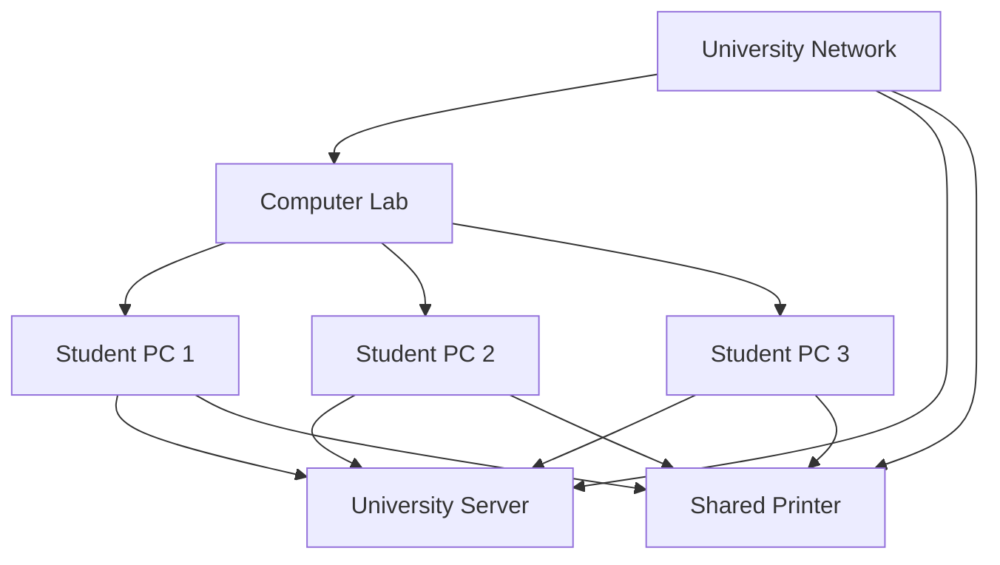

# 🌐 Purpose of Computer Networking

  
  
  

---

## 📌 1. Introduction

Computer networking is designed to connect devices and enable them to communicate, exchange information, and share resources.

The **primary purpose of computer networking** is to make communication and resource sharing easier, faster, and more efficient between connected devices.

Instead of working independently, computers can work together through a network and access shared information, applications, hardware, and services.

### 💡 Simple Example

Imagine an office with 20 employees:

- All employees need access to the same printer.
- Employees need to exchange files and documents.
- Managers need to access company data remotely.
- Teams need to communicate through email and video calls.

A computer network makes all these activities possible without requiring every employee to work independently.

---

## 🎯 2. Main Purposes of Computer Networking

Computer networking serves several important purposes in homes, educational institutions, businesses, and organizations.

### 1. Communication

**Definition:** Networking enables people and devices to communicate with each other through digital communication technologies.

**Examples:**
- Sending emails.
- Instant messaging through WhatsApp.
- Voice and video calls.
- Online meetings through Zoom and Microsoft Teams.

**Real-World Scenario:**

An employee in Pakistan can communicate with a colleague in the United States through email or a video conference.

### 2. Resource Sharing

**Definition:** Resource sharing allows multiple users to access and use common hardware, software, and network resources.

**Examples:**
- Sharing network printers.
- Sharing storage devices.
- Accessing shared applications.
- Using centralized servers.

**Real-World Scenario:**

In an office, 15 employees can use one network printer instead of purchasing a separate printer for every employee.

### 3. Data and File Sharing

**Definition:** Networking enables users to exchange digital information and files between connected devices.

**Examples:**
- Sharing documents and PDFs.
- Transferring images and videos.
- Accessing shared folders.
- Uploading and downloading files.

**Real-World Scenario:**

A university student can share an assignment with classmates through Google Drive or a shared network folder.

### 4. Remote Access

**Definition:** Remote access allows authorized users to access computers, servers, applications, and network resources from different geographical locations.

**Examples:**
- Remote Desktop Protocol (RDP).
- Virtual Private Network (VPN).
- Remote server administration.
- Accessing office systems from home.

**Real-World Scenario:**

A network administrator can securely access and troubleshoot an office server while working from home through a VPN.

### 5. Centralized Management

**Definition:** Centralized management allows administrators to manage network devices, users, security policies, and resources from a central location.

**Examples:**
- Managing user accounts.
- Applying security policies.
- Monitoring network devices.
- Managing centralized file servers.
- Controlling user permissions.

**Real-World Scenario:**

An IT administrator can manage employee accounts and access permissions across an organization using centralized management systems.

### 6. Collaboration

**Definition:** Networking allows multiple users to work together on projects, documents, and applications regardless of their physical location.

**Examples:**
- Google Docs collaboration.
- Microsoft Teams.
- Shared project management platforms.
- Online learning platforms.

**Real-World Scenario:**

Students from different cities can work together on the same project using Google Docs without being physically present in one location.

### 7. Connectivity

**Definition:** Connectivity enables different computers, networks, and devices to communicate with each other through networking infrastructure.

**Examples:**
- Connecting computers through LAN.
- Connecting different offices through WAN.
- Connecting wireless devices through Wi-Fi.
- Accessing the Internet.

**Real-World Scenario:**

A company with offices in Multan, Lahore, and Karachi can connect its locations through networking technologies and communicate with each other.

---

## 📊 3. Summary of Networking Purposes

| Purpose | Main Function | Example |
|---|---|---|
| Communication | Enables interaction | Email, video calls |
| Resource Sharing | Shares common resources | Network printer |
| Data Sharing | Exchanges information | File transfer |
| Remote Access | Accesses systems remotely | VPN, RDP |
| Centralized Management | Manages resources centrally | User management |
| Collaboration | Supports teamwork | Google Docs |
| Connectivity | Connects devices and networks | LAN, WAN |

---

## 🔄 4. How Networking Purposes Work Together

Different networking purposes often work together to support everyday digital activities.

### Example: A University Computer Lab

Consider a university computer laboratory where multiple students use connected computers.

- **Communication:** Students communicate with instructors through online platforms.
- **Resource Sharing:** Multiple computers use a shared printer.
- **Data Sharing:** Students exchange assignments and learning materials.
- **Remote Access:** Authorized students access university resources remotely.
- **Centralized Management:** IT administrators manage laboratory computers.
- **Collaboration:** Students work together on shared projects.
- **Connectivity:** All laboratory computers connect to the university network.

### Network Diagram

*Illustration: Multiple computers accessing shared network resources.*

---

## 🏢 5. Real-World Applications

Computer networking supports different industries and makes their operations more efficient.

| Industry | Purpose of Networking | Example |
|---|---|---|
| Education | Communication and collaboration | Online classes |
| Banking | Data exchange and connectivity | ATM networks |
| Healthcare | Data sharing | Hospital information systems |
| Business | Resource sharing | Shared office printers |
| E-Commerce | Connectivity and communication | Online shopping |
| Government | Centralized management | Digital government services |
| IT Companies | Remote access and collaboration | Remote server administration |
| Telecommunications | Connectivity | Mobile networks |

---

## 🔐 6. Importance of Networking Purposes in Cybersecurity

Understanding the purposes of networking is important for anyone pursuing a career in networking or cybersecurity.

Every network communication and shared resource can introduce security considerations.

Cybersecurity professionals need to understand how networks operate to protect systems, users, and organizational information.

### Why It Matters

| Networking Purpose | Cybersecurity Relevance |
|---|---|
| Communication | Monitoring network communication |
| Resource Sharing | Controlling access to shared resources |
| Data Sharing | Protecting sensitive information |
| Remote Access | Securing VPN and remote connections |
| Centralized Management | Managing user permissions and security policies |
| Collaboration | Preventing unauthorized access to shared platforms |
| Connectivity | Monitoring network traffic and connections |

### Practical Cybersecurity Examples

- **Firewall:** Controls incoming and outgoing network traffic.
- **VPN:** Provides an encrypted connection for remote access.
- **Access Control:** Restricts unauthorized users from accessing resources.
- **Network Monitoring:** Helps identify suspicious network activities.
- **Traffic Analysis:** Helps security professionals investigate network communication.

Understanding these concepts provides a foundation for Network Security, SOC operations, and penetration testing.

---

## 🛠️ 7. Practical Networking Examples

The following examples demonstrate how networking purposes are used in real environments.

| Scenario | Networking Purpose |
|---|---|
| Sending an email | Communication |
| Printing from another computer | Resource Sharing |
| Transferring a PDF file | Data Sharing |
| Accessing an office PC remotely | Remote Access |
| Managing employee accounts | Centralized Management |
| Editing a shared document | Collaboration |
| Connecting two office branches | Connectivity |

### Try It Yourself

You can explore these concepts through practical networking tools and environments:

- Cisco Packet Tracer – Build and test network topologies.
- Windows Command Prompt – Explore network connectivity.
- VirtualBox – Create virtual networking environments.
- Wireshark – Observe and analyze network traffic.

---

## 📝 8. Key Takeaways

- The primary purpose of networking is communication and resource sharing.
- Networks allow users to exchange files and information.
- Shared resources reduce hardware and operational costs.
- Remote access enables users to access systems from different locations.
- Centralized management makes network administration easier.
- Collaboration allows multiple users to work together.
- Connectivity links devices and networks.
- Networking knowledge is essential for cybersecurity professionals.

---

## 🧠 9. Knowledge Check

Test your understanding of the topic:

1. What is the primary purpose of computer networking?
2. What is resource sharing? Give two examples.
3. How does networking support communication?
4. What is the difference between data sharing and resource sharing?
5. What is remote access? Explain with an example.
6. What is centralized network management?
7. How does networking support collaboration?
8. How can networking connect offices in different cities?
9. Why is networking important in cybersecurity?
10. Give three real-world applications of computer networking.

---

## 📚 10. References & Further Learning

Explore these official learning resources to improve your networking knowledge:

- [Cisco Networking Academy](https://www.netacad.com/)
- [Cisco Official Website](https://www.cisco.com/)
- [Cloudflare Learning Center](https://www.cloudflare.com/learning/)
- [Wireshark Documentation](https://www.wireshark.org/docs/)

---

## 🔗 11. Related Topics

Continue exploring Networking Fundamentals:

- [What is Computer Networking?](./01-What-is-Computer-Networking.md)
- [Importance of Networking](./03-Importance-of-Networking.md)
- [Advantages and Disadvantages](./04-Advantages-and-Disadvantages.md)
- [How Computer Networks Work](./05-How-Computer-Networks-Work.md)
- [Basic Networking Terminologies](./07-Basic-Networking-Terminologies.md)

---

  <b>Networking & Cybersecurity Portfolio</b>
   
  <i>Learn • Practice • Document • Improve</i>
    
  ⭐ Building a strong foundation in Computer Networking and Cybersecurity.

