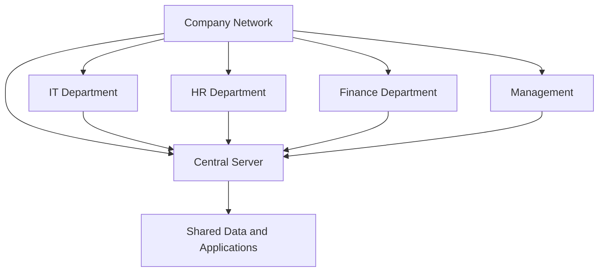

# 🌐 Importance of Computer Networking

<p align="center">
  
  
  
</p>

---

## 📌 1. Introduction

Computer networking plays an essential role in modern technology. It connects computers, servers, smartphones, and other devices, allowing them to communicate and share information.

Networking is important because it makes communication faster, improves productivity, reduces operational costs, and provides access to digital resources from different locations.

Today, networking is used in almost every industry, including education, banking, healthcare, business, telecommunications, and cybersecurity.

### 💡 Simple Example

Imagine a university with multiple departments:

- Students access online learning platforms.
- Teachers share educational materials.
- Administrators manage student records.
- Departments share printers and files.
- Students attend online classes.

All these activities depend on reliable networking infrastructure.

---

## 🎯 2. Why Is Computer Networking Important?

Computer networking provides several benefits that make modern communication and information exchange possible.

### 1. Fast Communication

**Definition:** Networking enables people and organizations to exchange information quickly, regardless of geographical distance.

**Examples:**
- Emails and instant messaging.
- Voice and video calls.
- Online meetings.
- Real-time communication.

**Real-World Scenario:**

A company in Pakistan can communicate with its international clients through video conferencing without requiring physical meetings.

### 2. Improved Resource Sharing

**Definition:** Networking allows multiple users to access shared hardware, software, storage, and other resources.

**Examples:**
- Shared network printers.
- Centralized storage.
- Shared applications.
- Network servers.

**Real-World Scenario:**

An organization can connect 50 employees to a shared printer instead of purchasing a separate printer for every employee.

### 3. Cost Reduction

**Definition:** Networking helps organizations reduce operational expenses by sharing resources and managing infrastructure efficiently.

**Examples:**
- Sharing printers and storage devices.
- Reducing duplicate hardware purchases.
- Centralized software management.
- Reducing communication expenses.

**Real-World Scenario:**

A small business can use one centralized file server to provide shared storage for multiple employees instead of maintaining separate storage systems.

### 4. Increased Productivity

**Definition:** Networking improves productivity by making information, applications, and communication tools easily accessible.

**Examples:**
- Quick file transfers.
- Shared project platforms.
- Online collaboration.
- Faster access to organizational resources.

**Real-World Scenario:**

Employees can work on shared documents simultaneously, reducing delays and improving teamwork.

### 5. Global Connectivity

**Definition:** Networking connects people, businesses, and systems across different geographical locations.

**Examples:**
- Internet connectivity.
- International communication.
- Global business operations.
- Worldwide information access.

**Real-World Scenario:**

A student in Pakistan can attend an online course offered by an international university.

### 6. Centralized Data Management

**Definition:** Networking allows organizations to store, organize, manage, and control information through centralized systems.

**Examples:**
- Centralized databases.
- File servers.
- User account management.
- Centralized backups.

**Real-World Scenario:**

A university can maintain student records in a centralized database that authorized departments can access.

### 7. Remote Working and Accessibility

**Definition:** Networking enables users to access organizational systems and digital resources from remote locations.

**Examples:**
- VPN connections.
- Remote Desktop.
- Cloud applications.
- Remote server administration.

**Real-World Scenario:**

An IT engineer can troubleshoot an office network remotely without physically visiting the office.

### 8. Better Data Management and Backup

**Definition:** Networking supports centralized storage, data synchronization, and backup solutions that help organizations protect important information.

**Examples:**
- Network-attached storage (NAS).
- Cloud backups.
- Centralized file servers.
- Data synchronization.

**Real-World Scenario:**

A company can back up important business files to centralized storage to help recover information after accidental deletion or hardware failure.

### 9. Support for Cybersecurity

**Definition:** Networking provides the infrastructure through which organizations implement security controls, monitor communication, and protect connected systems.

**Examples:**
- Firewalls.
- Network monitoring.
- Access control.
- VPN security.
- Intrusion Detection Systems (IDS).

**Real-World Scenario:**

A SOC analyst monitors network traffic to identify suspicious connections and investigate possible security incidents.

---

## 📊 3. Summary of Networking Importance

| Importance | Main Benefit | Example |
|---|---|---|
| Fast Communication | Quick information exchange | Email and video calls |
| Resource Sharing | Efficient resource utilization | Shared printers |
| Cost Reduction | Lower operational expenses | Centralized storage |
| Productivity | Efficient teamwork | Shared documents |
| Global Connectivity | Worldwide communication | Internet |
| Centralized Management | Organized data administration | Centralized databases |
| Remote Accessibility | Access from different locations | VPN |
| Data Backup | Better data recovery capabilities | Cloud backup |
| Cybersecurity | Protection and monitoring | Firewalls and IDS |

---

## 🏢 4. Importance of Networking in Different Industries

Computer networking is essential for the operation of modern organizations.

| Industry | Importance | Real-World Application |
|---|---|---|
| Education | Supports digital learning | Online classes and university portals |
| Banking | Enables secure communication and transactions | ATM and online banking |
| Healthcare | Supports information exchange | Electronic health records |
| Business | Improves communication and productivity | Enterprise networks |
| E-Commerce | Connects customers and online platforms | Online shopping |
| Government | Supports digital public services | Government portals |
| Telecommunications | Provides communication infrastructure | Mobile networks |
| IT Industry | Enables infrastructure management | Cloud and server administration |

---

## 🔄 5. How Networking Supports an Organization

A computer network allows different departments to communicate and access centralized organizational resources.

### Example: A Company Network

Consider an organization with multiple departments connected to a central network.



**Explanation:**

- Different departments connect to the company network.
- Employees access authorized shared resources.
- The central server provides shared data and applications.
- Network administrators manage connectivity and access.
- Security policies help protect organizational information.

---

## 🔐 6. Importance of Networking in Cybersecurity

Networking is one of the fundamental areas of cybersecurity.

A cybersecurity professional must understand network communication, devices, protocols, IP addressing, and traffic flow to identify and investigate security threats.

### Why Networking Knowledge Matters

| Networking Concept | Cybersecurity Application |
|---|---|
| IP Addressing | Identifying devices and analyzing connections |
| Network Traffic | Monitoring and investigating communication |
| Firewalls | Filtering unauthorized traffic |
| Routing | Understanding packet movement |
| Switching | Understanding communication within LANs |
| DNS | Investigating domain-related threats |
| VPN | Securing remote connections |
| Network Protocols | Understanding communication and potential vulnerabilities |

### Networking Skills Used in Cybersecurity

**1. Network Monitoring**

Monitoring network activity to identify unusual communication patterns.

**2. Traffic Analysis**

Analyzing network packets using tools such as Wireshark.

**3. Threat Detection**

Identifying suspicious connections and potential attacks.

**4. Access Control**

Restricting unauthorized users from accessing network resources.

**5. Incident Response**

Investigating network-related security incidents.

**6. Network Security Administration**

Configuring firewalls, security policies, and network protection mechanisms.

### Connection with Cybersecurity Careers

Networking knowledge is particularly useful in the following roles:

- SOC Analyst
- Network Security Engineer
- Security Analyst
- Penetration Tester
- Network Administrator
- Cybersecurity Engineer

---

## 🛠️ 7. Practical Networking Tools

The following tools help students develop practical networking and troubleshooting skills.

| Tool | Purpose |
|---|---|
| Cisco Packet Tracer | Simulating and designing network topologies |
| Wireshark | Capturing and analyzing network packets |
| Nmap | Network discovery and security auditing |
| Windows CMD | Basic network troubleshooting |
| Linux Terminal | Network configuration and troubleshooting |
| PuTTY | Remote device administration through supported protocols |

### Basic Commands for Network Troubleshooting

**1. Check IP Configuration**

```powershell
ipconfig /all
```

Displays detailed network adapter configuration.

**2. Test Network Connectivity**

```powershell
ping 8.8.8.8
```

Tests connectivity to a destination using ICMP.

**3. Check Network Route**

```powershell
tracert google.com
```

Displays the network path towards a destination.

**4. Check DNS Resolution**

```powershell
nslookup google.com
```

Queries DNS information for a domain.

**5. Display Network Connections**

```powershell
netstat -ano
```

Displays network connections and associated process IDs.

---

## ⚖️ 8. Networking Without vs. With Networking

| Without Networking | With Networking |
|---|---|
| Devices work independently | Devices communicate with each other |
| Manual file transfer may be required | Files can be shared over a network |
| Separate printers may be needed | Printers can be shared |
| Communication is less efficient | Fast digital communication |
| Data management may be distributed | Centralized management is possible |
| Remote access is difficult | Remote access technologies are available |
| Collaboration is limited | Real-time collaboration is supported |

---

## 📝 9. Key Takeaways

- Computer networking is essential for modern digital communication.
- It improves communication between individuals and organizations.
- Resource sharing reduces hardware and operational costs.
- Networking increases productivity and collaboration.
- Global connectivity allows people to communicate worldwide.
- Centralized management helps organizations manage their resources.
- Remote access supports flexible working environments.
- Networking plays a major role in data management and backup.
- Networking knowledge is fundamental to cybersecurity.

---

## 🧠 10. Knowledge Check

Test your understanding of the topic:

1. Why is computer networking important in modern technology?
2. How does networking improve communication?
3. How can networking reduce organizational costs?
4. What is the relationship between networking and productivity?
5. How does networking support global connectivity?
6. What is centralized data management?
7. How does networking support remote working?
8. Why is networking important for cybersecurity?
9. What is the role of a firewall in network security?
10. Name three networking tools used by cybersecurity professionals.

---

## 📚 11. References & Further Learning

Explore these resources to improve your networking knowledge:

- [Cisco Networking Academy](https://www.netacad.com/)
- [Cisco Official Website](https://www.cisco.com/)
- [Cloudflare Learning Center](https://www.cloudflare.com/learning/)
- [Wireshark Documentation](https://www.wireshark.org/docs/)
- [Nmap Official Documentation](https://nmap.org/book/)

---

## 🔗 12. Related Topics

Continue exploring Networking Fundamentals:

- [What is Computer Networking?](./01-What-is-Computer-Networking.md)
- [Purpose of Networking](./02-Purpose-of-Networking.md)
- [Advantages and Disadvantages](./04-Advantages-and-Disadvantages.md)
- [How Computer Networks Work](./05-How-Computer-Networks-Work.md)
- [Basic Networking Terminologies](./07-Basic-Networking-Terminologies.md)

---

<p align="center">
  <b>Networking & Cybersecurity Portfolio</b>
  <br/>
  <i>Learn • Practice • Document • Improve</i>
  <br/><br/>
  ⭐ Building a strong foundation in Computer Networking and Cybersecurity.
</p>