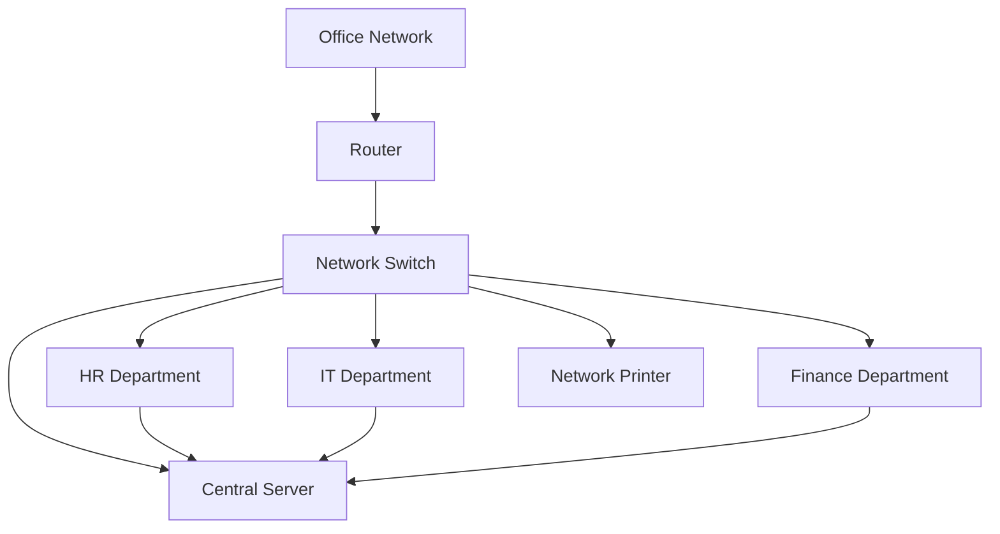

# 🌐 Advantages & Disadvantages of Computer Networking

  
  
  

---

## 📌 1. Introduction

Computer networking provides many benefits to individuals, businesses, educational institutions, and organizations. It allows connected devices to communicate, share resources, exchange information, and access services.

However, networking also has certain disadvantages, including security risks, installation costs, maintenance requirements, and dependence on network availability.

Understanding both advantages and disadvantages helps organizations design, implement, and manage networks effectively.

### 💡 Simple Example

Consider a company with 30 employees:

- Employees can share files through a central server.
- Multiple users can access the same network printer.
- Teams can communicate through online platforms.
- Employees can access company resources remotely.

These are some major advantages of networking.

However, if the network server fails or a security attack occurs, multiple employees may lose access to important resources.

This demonstrates that networking offers significant benefits but also introduces potential risks.

---

## ✅ 2. Advantages of Computer Networking

Computer networking provides several advantages that improve communication, productivity, and resource management.

### 1. Resource Sharing

**Definition:** Networking allows multiple users to share hardware, software, storage, and other network resources.

**Examples:**
- Sharing network printers.
- Sharing storage devices.
- Accessing common applications.
- Using centralized servers.

**Real-World Scenario:**

An office with 20 employees can use one shared network printer instead of purchasing 20 separate printers.

**Benefit:** Reduces hardware expenses and improves resource utilization.

### 2. Fast Communication

**Definition:** Networking enables users to exchange information quickly through digital communication technologies.

**Examples:**
- Email.
- Instant messaging.
- Voice and video calls.
- Online meetings.

**Real-World Scenario:**

An employee in Pakistan can communicate with an international client through a video conference.

**Benefit:** Saves time and improves communication efficiency.

### 3. Data and File Sharing

**Definition:** Networking allows users to exchange files and information between connected devices.

**Examples:**
- Sharing documents.
- Transferring images and videos.
- Accessing shared folders.
- Uploading and downloading files.

**Real-World Scenario:**

Students can share assignments and study materials through a shared network folder or cloud storage.

**Benefit:** Makes information exchange easier and faster.

### 4. Cost Reduction

**Definition:** Networking reduces operational costs by allowing organizations to share resources and manage infrastructure efficiently.

**Examples:**
- Shared printers.
- Centralized storage.
- Shared software resources.
- Reduced communication expenses.

**Real-World Scenario:**

A company can maintain a central file server instead of purchasing separate storage systems for every employee.

**Benefit:** Reduces unnecessary hardware and operational expenses.

### 5. Centralized Data Management

**Definition:** Networking allows organizations to store and manage information through centralized servers and databases.

**Examples:**
- Centralized databases.
- File servers.
- User account management.
- Centralized backups.

**Real-World Scenario:**

A university maintains student records in a centralized database that authorized departments can access.

**Benefit:** Makes data management and administration easier.

### 6. Remote Access

**Definition:** Networking allows authorized users to access systems and resources from different geographical locations.

**Examples:**
- Virtual Private Network (VPN).
- Remote Desktop Protocol (RDP).
- Cloud applications.
- Remote server administration.

**Real-World Scenario:**

A network administrator can troubleshoot an office server remotely while working from home.

**Benefit:** Provides flexibility and supports remote working.

### 7. Improved Collaboration

**Definition:** Networking allows multiple users to work together through shared applications and communication platforms.

**Examples:**
- Google Docs.
- Microsoft Teams.
- Shared project management platforms.
- Online learning platforms.

**Real-World Scenario:**

Students from different cities can collaborate on the same assignment using Google Docs.

**Benefit:** Improves teamwork and productivity.

### 8. Scalability

**Definition:** Networking allows organizations to expand their infrastructure by adding more devices, users, and network resources.

**Examples:**
- Adding new computers.
- Connecting additional departments.
- Expanding wireless coverage.
- Increasing server capacity.

**Real-World Scenario:**

A company can expand its network when it hires new employees or opens another office.

**Benefit:** Supports organizational growth.

### 9. Improved Data Backup and Recovery

**Definition:** Networking supports centralized backup systems that help organizations protect and recover important information.

**Examples:**
- Network-attached storage (NAS).
- Cloud backups.
- Centralized backup servers.
- Data synchronization.

**Real-World Scenario:**

A company regularly backs up its important files to a centralized backup system to help recover data after accidental deletion or hardware failure.

**Benefit:** Improves data availability and recovery capabilities.

---

## ❌ 3. Disadvantages of Computer Networking

Despite its benefits, computer networking also has several disadvantages and challenges.

### 1. Security Risks

**Definition:** Networks can be targeted by cybercriminals who attempt to gain unauthorized access, steal information, or disrupt services.

**Examples:**
- Malware attacks.
- Unauthorized access.
- Phishing-related network compromise.
- Denial-of-Service (DoS) attacks.

**Real-World Scenario:**

An attacker exploits a vulnerable network device to gain unauthorized access to an organization's internal network.

**Disadvantage:** Sensitive information and network resources may be exposed.

### 2. High Initial Setup Cost

**Definition:** Building a reliable network may require significant initial investment in hardware, software, infrastructure, and installation.

**Examples:**
- Routers and switches.
- Servers.
- Ethernet and fiber-optic cables.
- Firewalls.
- Network installation.

**Real-World Scenario:**

A company establishing a new office must purchase networking equipment and hire professionals to configure its infrastructure.

**Disadvantage:** Initial implementation can be expensive.

### 3. Network Maintenance

**Definition:** Networks require regular monitoring, troubleshooting, updates, and maintenance to operate efficiently.

**Examples:**
- Updating network devices.
- Replacing faulty cables.
- Configuring routers and switches.
- Monitoring network performance.

**Real-World Scenario:**

An organization hires network administrators to monitor and maintain its network infrastructure.

**Disadvantage:** Requires time, technical expertise, and additional expenses.

### 4. Dependence on Network Availability

**Definition:** Users may lose access to shared resources and services when network connectivity or critical network devices fail.

**Examples:**
- Server failure.
- Router malfunction.
- Internet service interruption.
- Switch failure.

**Real-World Scenario:**

If a company's central server becomes unavailable, employees may temporarily lose access to shared files and applications.

**Disadvantage:** Network failures can interrupt business operations.

### 5. Malware and Virus Spreading

**Definition:** Malicious software can spread between connected devices if proper security controls are not implemented.

**Examples:**
- Computer viruses.
- Worms.
- Ransomware.
- Trojan malware.

**Real-World Scenario:**

An infected computer spreads malware to other vulnerable systems connected to the same network.

**Disadvantage:** Multiple devices and organizational resources may become affected.

### 6. Privacy Concerns

**Definition:** Improper network security can expose personal, organizational, or confidential information to unauthorized parties.

**Examples:**
- Data interception.
- Unauthorized monitoring.
- Information leakage.
- Weak access controls.

**Real-World Scenario:**

Sensitive information transmitted over an unsecured network may be intercepted by an attacker.

**Disadvantage:** User privacy and data confidentiality can be compromised.

### 7. Technical Complexity

**Definition:** Designing, configuring, securing, and maintaining large networks requires specialized technical knowledge.

**Examples:**
- IP addressing and subnetting.
- VLAN configuration.
- Routing protocols.
- Firewall policies.
- Network troubleshooting.

**Real-World Scenario:**

An enterprise network administrator must configure multiple routers, switches, VLANs, and security policies.

**Disadvantage:** Requires trained professionals and continuous learning.

### 8. Performance Issues

**Definition:** Network performance can decrease due to congestion, insufficient bandwidth, hardware limitations, or configuration problems.

**Examples:**
- Slow file transfers.
- High latency.
- Packet loss.
- Network congestion.

**Real-World Scenario:**

When many employees use the same network simultaneously, internet speed and application performance may decrease.

**Disadvantage:** Can reduce productivity and affect user experience.

---

## 📊 4. Advantages vs. Disadvantages Comparison

| Advantages | Disadvantages |
|---|---|
| Resource sharing | Security risks |
| Fast communication | High initial setup cost |
| Data and file sharing | Regular maintenance |
| Cost reduction | Dependence on network availability |
| Centralized management | Malware spreading |
| Remote access | Privacy concerns |
| Improved collaboration | Technical complexity |
| Scalability | Performance issues |
| Data backup and recovery | Additional backup infrastructure costs |

---

## 🔄 5. Real-World Example: Office Network

Consider an organization with multiple departments connected through a common network.

### Network Structure

### Advantages in This Network

- Employees can share files through the central server.
- Different departments can use a shared printer.
- Communication between departments becomes easier.
- Network administrators can manage connected devices.
- Centralized storage supports data management.

### Possible Disadvantages

- Server failure can interrupt access to shared resources.
- Unauthorized access may expose sensitive information.
- Network congestion can affect performance.
- Equipment installation and maintenance require investment.

**Conclusion:** Proper network design, security controls, and regular maintenance help organizations benefit from networking while reducing potential risks.

---

## 🔐 6. Networking Advantages and Disadvantages in Cybersecurity

Networking is closely connected to cybersecurity because connected systems communicate and exchange information through network infrastructure.

Cybersecurity professionals must understand the benefits and risks associated with network connectivity.

### Security Risks and Their Countermeasures

| Potential Risk | Security Measure |
|---|---|
| Unauthorized Access | Strong authentication and access control |
| Malware Spreading | Endpoint protection and network segmentation |
| Data Interception | Encryption and secure communication protocols |
| DoS Attacks | Traffic filtering and DDoS protection |
| Network Vulnerabilities | Regular patching and security updates |
| Data Loss | Regular backups and recovery plans |
| Suspicious Network Traffic | Network monitoring and IDS/IPS |

### Important Security Technologies

**1. Firewall**

Filters incoming and outgoing network traffic according to security rules.

**2. VPN**

Provides an encrypted connection for supported remote-access scenarios.

**3. IDS (Intrusion Detection System)**

Monitors network or system activity to identify suspicious behavior.

**4. IPS (Intrusion Prevention System)**

Detects and can block malicious network activity.

**5. Network Segmentation**

Divides a network into separate sections to help limit unauthorized access and contain security incidents.

**6. Encryption**

Protects information by making it unreadable to unauthorized parties.

### Connection with Cybersecurity Careers

Knowledge of networking risks and security controls is valuable for:

- SOC Analyst
- Network Security Engineer
- Security Analyst
- Penetration Tester
- Cybersecurity Engineer
- Network Administrator

---

## 🛠️ 7. Practical Learning Tools

You can explore networking advantages and disadvantages through practical tools and laboratory environments.

| Tool | Practical Use |
|---|---|
| Cisco Packet Tracer | Build and simulate network topologies |
| Wireshark | Analyze network traffic |
| Nmap | Network discovery and security auditing |
| Kali Linux | Learn authorized security testing |
| VirtualBox | Create virtual networking environments |
| Windows CMD | Perform basic network troubleshooting |

### Suggested Practical Activities

1. Build a small office network in Cisco Packet Tracer.
2. Connect multiple PCs through a switch.
3. Configure IP addresses for connected devices.
4. Test connectivity using the `ping` command.
5. Configure VLANs to separate departments.
6. Observe network traffic using Wireshark.

---

## 📝 8. Key Takeaways

- Networking enables communication and resource sharing.
- It reduces operational costs through shared resources.
- It improves collaboration and productivity.
- Centralized management makes administration easier.
- Remote access supports flexible working.
- Networking requires initial investment and regular maintenance.
- Security threats can affect connected devices and information.
- Network failures can interrupt services and business operations.
- Proper network security helps reduce risks.
- Understanding networking advantages and disadvantages is important for IT and cybersecurity professionals.

---

## 🧠 9. Knowledge Check

Test your understanding of this topic:

1. What are the major advantages of computer networking?
2. How does networking help reduce organizational costs?
3. Explain the importance of resource sharing.
4. What is remote access?
5. What are the major disadvantages of computer networking?
6. Why can networking introduce security risks?
7. How can malware spread through a network?
8. What is network congestion?
9. How can organizations protect their networks from unauthorized access?
10. Explain the difference between IDS and IPS.
11. Why is regular network maintenance important?
12. How does network segmentation improve security?

---

## 📚 10. References & Further Learning

Explore these resources to strengthen your networking knowledge:

- [Cisco Networking Academy](https://www.netacad.com/)
- [Cisco Official Website](https://www.cisco.com/)
- [Cloudflare Learning Center](https://www.cloudflare.com/learning/)
- [Wireshark Documentation](https://www.wireshark.org/docs/)
- [Nmap Official Documentation](https://nmap.org/book/)

---

## 🔗 11. Related Topics

Continue exploring Networking Fundamentals:

- [What is Computer Networking?](./01-What-is-Computer-Networking.md)
- [Purpose of Networking](./02-Purpose-of-Networking.md)
- [Importance of Networking](./03-Importance-of-Networking.md)
- [How Computer Networks Work](./05-How-Computer-Networks-Work.md)
- [Basic Networking Terminologies](./07-Basic-Networking-Terminologies.md)

---

  <b>Networking & Cybersecurity Portfolio</b>
   
  <i>Learn • Practice • Document • Improve</i>
    
  ⭐ Building a strong foundation in Computer Networking and Cybersecurity.

