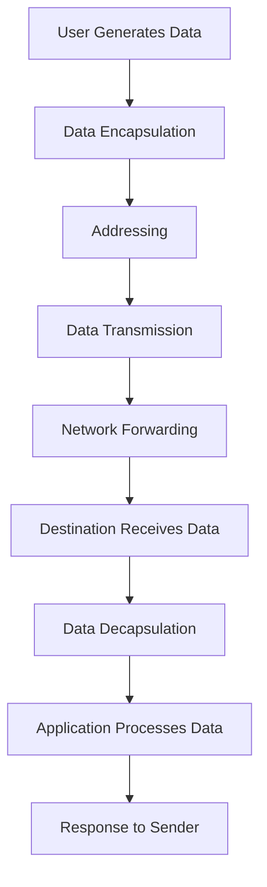
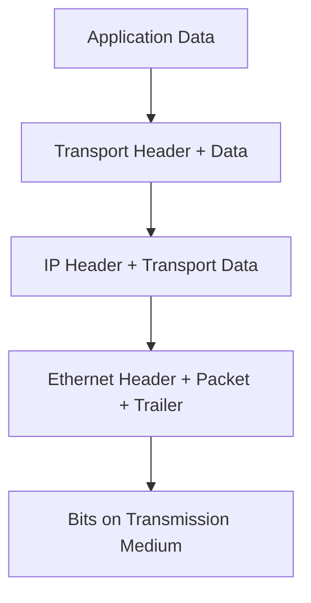
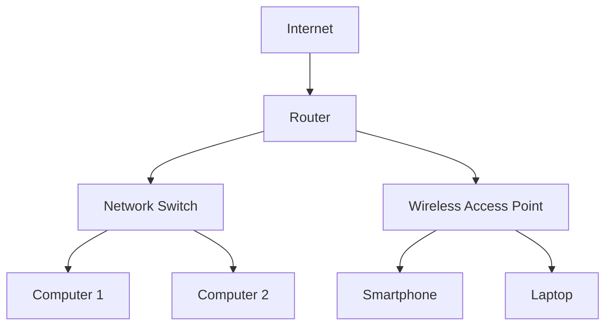
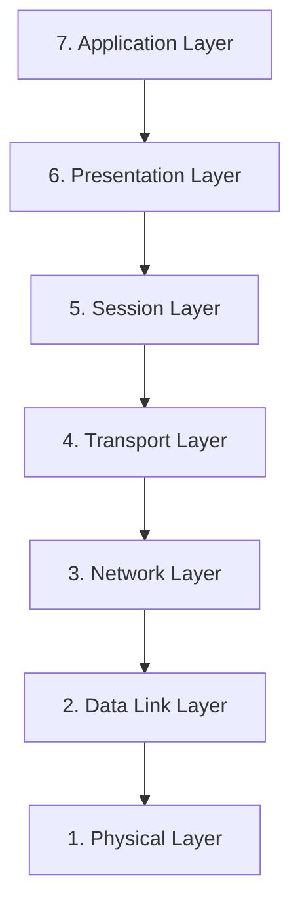
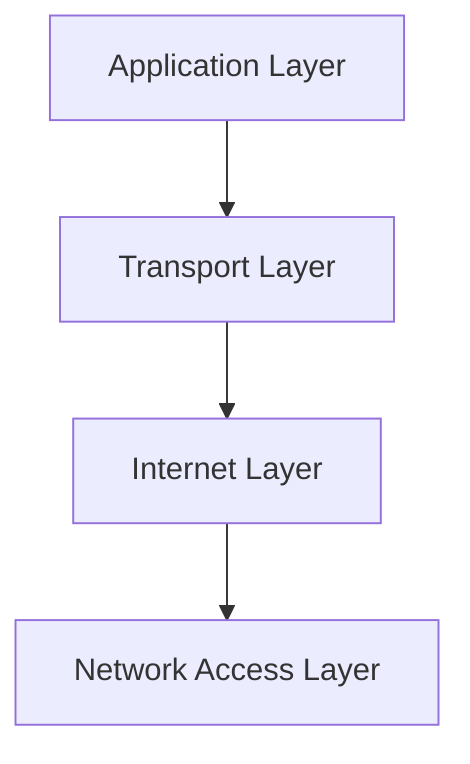
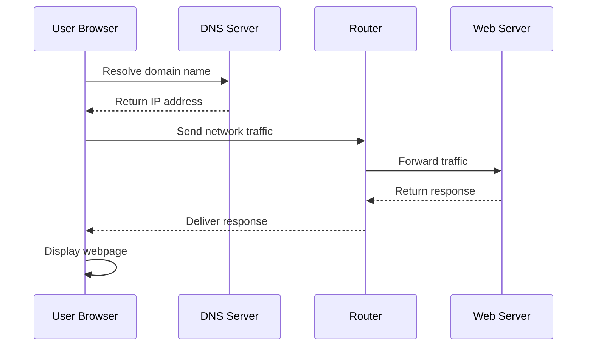

# 🌐 How Computer Networks Work

<p align="center">
  
  
  
</p>

<p align="center">
  <b>Understanding How Devices Communicate, Exchange Data, and Access Network Resources</b>
</p>

---

## 📌 1. Introduction

Computer networks work by connecting multiple devices and enabling them to exchange data through wired or wireless communication channels.

Whenever we send a message, browse a website, download a file, or access an online application, several networking technologies work together to deliver information to its destination.

These technologies include:

- Network devices such as routers and switches.
- Communication protocols such as TCP, UDP, and IP.
- Logical and physical addressing.
- Wired and wireless transmission media.
- Network services such as DNS and DHCP.

**In simple words:** Computer networking is the process of sending, receiving, and exchanging information between connected devices.

### 💡 Real-World Example

When you open Google in your browser:

1. You enter `www.google.com`.
2. DNS resolves the domain name into an IP address.
3. Your device determines how to reach the destination.
4. A connection is established with the web server.
5. Your browser sends an HTTP request.
6. Network devices forward the traffic towards its destination.
7. The server processes the request and sends a response.
8. Your browser receives and displays the webpage.

---

## ⚙️ 2. Basic Working Process of Computer Networks

Computer networks follow a structured communication process to transfer information between devices.

### Main Steps

**1. Data Generation**

A user creates information or sends a request using a computer, smartphone, or another network-connected device.

Example: Sending a message or requesting a webpage.

**2. Data Encapsulation**

The sending device prepares information for transmission by adding protocol-related headers and, where applicable, trailers.

**3. Addressing**

Source and destination addressing information helps deliver data to the correct destination.

- **IP Address:** Provides logical addressing at the network layer.
- **MAC Address:** Supports local link-layer communication.

**4. Data Transmission**

Data travels through wired or wireless communication media.

**5. Network Forwarding**

Switches forward Ethernet frames within a LAN, while routers forward IP packets between networks.

**6. Data Reception**

The destination device receives the transmitted data.

**7. Data Decapsulation**

The receiving device processes protocol information and removes headers and trailers as appropriate to recover the original application data.

**8. Response**

The destination device or server may send a response back to the original device.

### Network Communication Flow



---

## 📦 3. How Data Travels Across a Network

Before information is transmitted, networking technologies organize it into smaller units.

These units have different names depending on the networking layer.

| Networking Layer | Data Unit |
|---|---|
| Application | Data |
| Transport | Segment (TCP) / Datagram (UDP) |
| Network | Packet |
| Data Link | Frame |
| Physical | Bits |

### A. What Is Data Encapsulation?

**Definition:** Encapsulation is the process of adding protocol-related information to data as it moves down the networking layers before transmission.

Each layer adds information required for communication.

### Encapsulation Process



### B. What Is Data Decapsulation?

**Definition:** Decapsulation is the reverse process in which the receiving device processes protocol information and removes the corresponding headers and trailers to recover the original data.

**Example:** When a computer receives a webpage response, its networking layers process the incoming information until the browser receives the application data.

---

## 🧩 4. Role of Networking Devices

Different networking devices perform specific functions to make communication possible.

| Device | Main Function |
|---|---|
| Router | Forwards IP packets between different networks. |
| Switch | Connects devices within a LAN and forwards Ethernet frames. |
| Hub | Repeats incoming signals to all other ports. |
| Modem | Modulates and demodulates signals for supported ISP access technologies. |
| Access Point | Connects wireless devices to a network. |
| Firewall | Filters network traffic according to security rules. |
| Server | Provides services and resources to other devices. |
| Network Interface Card (NIC) | Provides a network interface for device connectivity. |

### Router vs. Switch

Routers and switches are two of the most important networking devices.

| Router | Switch |
|---|---|
| Connects different networks. | Connects devices within a LAN. |
| Forwards IP packets. | Forwards Ethernet frames. |
| Uses routing tables. | Uses MAC address tables. |
| Commonly operates at Layer 3. | Commonly operates at Layer 2. |

---

## 🏷️ 5. Understanding IP and MAC Addresses

Devices require addressing information to communicate over a network.

### A. IP Address

**Definition:** An IP address is a logical network-layer address assigned to a network interface for identification and communication.

Example:

```text
192.168.1.10
```

IP addresses help identify source and destination interfaces and allow routers to forward packets between networks.

**Types of IP Addresses:**

- IPv4
- IPv6

### B. MAC Address

**Definition:** A MAC address is a link-layer address associated with a network interface and commonly used for communication within a local network.

Example:

```text
00:1A:2B:3C:4D:5E
```

Ethernet switches learn MAC addresses and use their MAC address tables to forward frames within a LAN.

### IP Address vs. MAC Address

| IP Address | MAC Address |
|---|---|
| Logical addressing. | Link-layer addressing. |
| Used for network-layer communication. | Used for local link-layer communication. |
| IPv4 and IPv6 formats. | Commonly written in hexadecimal. |
| Used by routers for packet forwarding. | Used by switches for frame forwarding. |

### 💡 Simple Example

Think of sending a parcel:

- An IP address is similar to a destination postal address.
- A MAC address identifies the local network interface involved in frame delivery.

Both addressing systems perform different roles in network communication.

---

## 🌍 6. How Routers and Switches Work Together

Switches and routers work together to connect local devices with external networks.

### Example: Home Network

Consider a home network containing:

- Two desktop computers.
- One smartphone.
- One laptop.
- One network switch.
- One wireless access point.
- One router.

The switch connects wired devices, while the wireless access point provides Wi-Fi connectivity. The router forwards traffic between the home network and external networks.

### Network Diagram



### Explanation

1. Devices connect to the local network.
2. The switch forwards Ethernet frames between wired devices.
3. The access point connects wireless devices.
4. The router forwards traffic towards external networks.
5. Responses return through the network to the appropriate destination.

---

## 🔄 7. Understanding Network Protocols

**Definition:** A network protocol is a set of rules that controls how devices communicate and exchange information over a network.

Protocols define how data is formatted, transmitted, received, and processed.

### Important Networking Protocols

| Protocol | Full Form | Purpose |
|---|---|---|
| TCP | Transmission Control Protocol | Reliable, connection-oriented data delivery. |
| UDP | User Datagram Protocol | Connectionless data transmission. |
| IP | Internet Protocol | Logical addressing and packet forwarding. |
| HTTP | Hypertext Transfer Protocol | Transfers web resources. |
| HTTPS | Hypertext Transfer Protocol Secure | Secure HTTP communication using TLS. |
| DNS | Domain Name System | Resolves domain names into IP addresses. |
| DHCP | Dynamic Host Configuration Protocol | Automatically provides IP configuration. |
| FTP | File Transfer Protocol | Transfers files. |
| SSH | Secure Shell | Secure remote administration. |
| ARP | Address Resolution Protocol | Resolves IPv4 addresses to MAC addresses on a local link. |

### TCP vs. UDP

| TCP | UDP |
|---|---|
| Connection-oriented. | Connectionless. |
| Provides reliable delivery. | Does not guarantee delivery. |
| Uses acknowledgments and retransmissions. | No built-in delivery acknowledgments or retransmissions. |
| Maintains data ordering. | Does not guarantee data ordering. |
| Commonly used for web and file transfers. | Commonly used for DNS queries and real-time applications. |

---

## 🏗️ 8. OSI Model and Network Communication

The OSI (Open Systems Interconnection) model explains network communication through seven conceptual layers.

Each layer performs a specific function and works with the layers above and below it.

### Seven Layers of the OSI Model

| Layer | Name | Main Function |
|---|---|---|
| 7 | Application | Provides network services to applications. |
| 6 | Presentation | Handles data representation, encryption, and compression concepts. |
| 5 | Session | Manages communication sessions. |
| 4 | Transport | Provides end-to-end transport services. |
| 3 | Network | Handles logical addressing and routing. |
| 2 | Data Link | Handles framing and local link delivery. |
| 1 | Physical | Transmits raw bits through physical media. |

### OSI Model Diagram



### Why Is the OSI Model Important?

- Helps understand network communication.
- Provides a structured troubleshooting approach.
- Explains the responsibilities of networking layers.
- Helps identify where communication problems occur.
- Provides a common reference for networking professionals.

---

## 🌐 9. TCP/IP Model

The TCP/IP model describes the architecture used for communication across modern IP networks, including the Internet.

It commonly uses four layers.

| Layer | Main Function | Examples |
|---|---|---|
| Application | Provides application-level network services. | HTTP, DNS, DHCP, SSH |
| Transport | Provides end-to-end transport. | TCP, UDP |
| Internet | Provides logical addressing and packet forwarding. | IPv4, IPv6, ICMP |
| Network Access | Handles local network access and transmission. | Ethernet, Wi-Fi |

### TCP/IP Communication Flow



**Important Note:** The OSI model has seven layers, whereas the commonly used TCP/IP model has four layers.

---

## 🌐 10. What Happens When You Open a Website?

Let's understand networking through a real-world example.

Imagine entering:

```text
https://www.google.com
```

Your browser needs to communicate with a web server to retrieve the requested content.

### Step-by-Step Process

**Step 1: User Request**

You enter the website address in your browser.

**Step 2: DNS Resolution**

Your device uses DNS to resolve the domain name into an IP address.

**Step 3: Network Connectivity**

Your device uses its IP configuration and routing information to determine how to reach the destination.

**Step 4: Connection Establishment**

For HTTPS over TCP, the client establishes a TCP connection and then performs a TLS handshake to secure communication.

Modern web connections may also use QUIC over UDP.

**Step 5: HTTP Request**

Your browser sends an HTTP request to the web server.

**Step 6: Server Processing**

The destination server processes the request and prepares a response.

**Step 7: Data Transmission**

The response travels through the network towards your device.

**Step 8: Webpage Display**

Your browser processes the response and displays the webpage.

### Website Communication Diagram



*Note: This is a simplified illustration. Actual communication may involve multiple routers, DNS resolvers, security services, and other network components.*

---

## 📡 11. Wired and Wireless Data Transmission

Computer networks use different communication media to transfer information.

### A. Wired Networking

Wired networking uses physical cables to transmit data.

**Common Technologies:**

- Ethernet cables.
- Fiber-optic cables.
- Coaxial cables.

**Advantages:**

- Reliable connectivity.
- Consistent performance.
- Suitable for structured enterprise networks.
- Predictable bandwidth and latency.

### B. Wireless Networking

Wireless networking uses radio waves to transmit data without requiring a physical data cable between communicating devices.

**Common Technologies:**

- Wi-Fi.
- Bluetooth.
- Cellular networks.
- Satellite communication.

**Advantages:**

- Mobility.
- Flexible connectivity.
- Reduced cable requirements.
- Convenient access for mobile devices.

---

## 🔍 12. Practical Networking Commands

Understanding networking commands is essential for checking connectivity and troubleshooting communication problems.

### Windows Commands

**1. Check IP Configuration**

```powershell
ipconfig
```

Displays basic network adapter configuration.

**2. Display Detailed Network Information**

```powershell
ipconfig /all
```

Displays IP addresses, MAC addresses, DNS servers, and other adapter details.

**3. Test Network Connectivity**

```powershell
ping 8.8.8.8
```

Tests connectivity to a destination using ICMP Echo Requests.

**4. Check Network Route**

```powershell
tracert google.com
```

Displays the network path towards a destination.

**5. Check DNS Resolution**

```powershell
nslookup google.com
```

Queries DNS information for a domain.

**6. Display Network Connections**

```powershell
netstat -ano
```

Displays network connections, listening ports, and associated process IDs.

### Linux Commands

```bash
ip addr
ip route
ping -c 4 8.8.8.8
traceroute google.com
nslookup google.com
```

These commands help develop practical networking and troubleshooting skills.

---

## 🛠️ 13. Practical Learning and Simulation Tools

You can understand network communication more effectively by building and testing network topologies.

| Tool | Purpose |
|---|---|
| Cisco Packet Tracer | Simulates routers, switches, PCs, and network topologies. |
| Wireshark | Captures and analyzes network packets. |
| Nmap | Performs network discovery and security auditing. |
| Kali Linux | Provides tools for authorized security testing. |
| VirtualBox | Creates virtual machines and networking environments. |
| PuTTY | Provides terminal access to supported remote devices. |

### Suggested Practical Activities

1. Create a basic LAN using Cisco Packet Tracer.
2. Connect two PCs through a switch.
3. Assign IP addresses to both computers.
4. Test communication using the `ping` command.
5. Add a router and connect two different networks.
6. Configure routing and test connectivity.
7. Capture network traffic using Wireshark.
8. Observe how packets move between devices.

---

## 🔐 14. How Computer Networks Work in Cybersecurity

Understanding network communication is essential for cybersecurity professionals.

Every time data travels through a network, security technologies help protect communication and connected devices.

### Important Cybersecurity Concepts

| Concept | Role |
|---|---|
| Firewall | Filters network traffic. |
| IDS | Detects suspicious network activity. |
| IPS | Detects and can prevent malicious traffic. |
| VPN | Provides encrypted network connectivity. |
| Encryption | Protects information from unauthorized reading. |
| Network Segmentation | Separates networks to control communication. |
| Packet Analysis | Helps investigate network activity. |

### Practical Cybersecurity Example

A SOC analyst investigates suspicious network activity.

The analyst may:

1. Identify source and destination IP addresses.
2. Examine network traffic.
3. Analyze suspicious connections.
4. Review firewall and system logs.
5. Identify potential malicious activity.
6. Report or escalate the security incident.

This is why networking fundamentals are important for SOC operations, penetration testing, and network security.

---

## 📝 15. Key Takeaways

- Computer networks connect devices and enable communication.
- Data travels through wired or wireless communication media.
- Encapsulation prepares data for transmission.
- Decapsulation processes received data.
- IP addresses provide logical network addressing.
- MAC addresses support local link-layer delivery.
- Routers forward packets between networks.
- Switches forward frames within local networks.
- Protocols define communication rules.
- The OSI model explains networking through seven layers.
- The TCP/IP model describes four layers of network communication.
- Networking knowledge is essential for cybersecurity and network troubleshooting.

---

## 🧠 16. Knowledge Check

Test your understanding of this topic:

1. How do computer networks work?
2. What are the main steps involved in network communication?
3. What is data encapsulation?
4. What is the difference between encapsulation and decapsulation?
5. What is the purpose of an IP address?
6. What is the purpose of a MAC address?
7. What is the difference between a router and a switch?
8. What is a network protocol?
9. Explain the seven layers of the OSI model.
10. What is the difference between the OSI and TCP/IP models?
11. What happens when you open a website?
12. What is the difference between TCP and UDP?
13. Which command is used to test network connectivity?
14. Why is networking knowledge important in cybersecurity?

---

## 📚 17. References & Further Learning

Explore these official resources to strengthen your networking knowledge.

| Resource | Learning Material |
|---|---|
| [Cisco Networking Academy](https://www.netacad.com/) | Networking courses and practical learning. |
| [Cisco Official Website](https://www.cisco.com/) | Networking technologies and documentation. |
| [Cloudflare Learning Center](https://www.cloudflare.com/learning/) | Networking and Internet concepts. |
| [Wireshark Documentation](https://www.wireshark.org/docs/) | Packet analysis and troubleshooting. |
| [RFC Editor](https://www.rfc-editor.org/) | Official Internet standards and protocols. |
| [Nmap Official Documentation](https://nmap.org/book/) | Network discovery and security auditing. |

---

## 🔗 18. Related Topics

Continue exploring Networking Fundamentals:

- [What is Computer Networking?](./01-What-is-Computer-Networking.md)
- [Purpose of Networking](./02-Purpose-of-Networking.md)
- [Importance of Networking](./03-Importance-of-Networking.md)
- [Advantages and Disadvantages](./04-Advantages-and-Disadvantages.md)
- [Basic Networking Terminologies](./07-Basic-Networking-Terminologies.md)

---

<p align="center">
  <b>🌐 Networking & Cybersecurity Portfolio</b>
  <br/>
  <i>Learn • Practice • Document • Improve</i>
  <br/><br/>
  ⭐ Building a strong foundation in Computer Networking and Cybersecurity.
</p>
