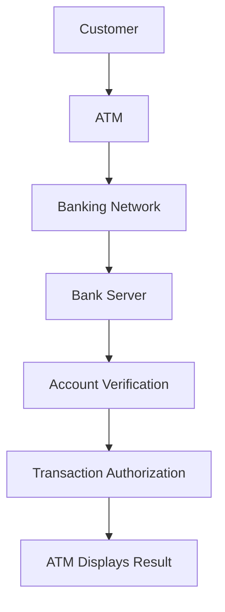
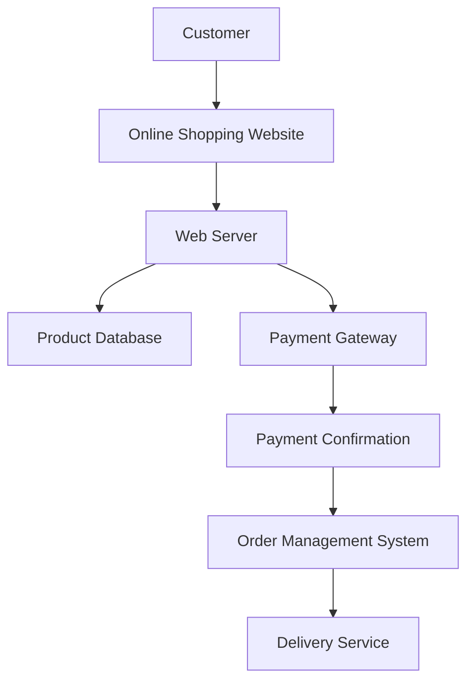
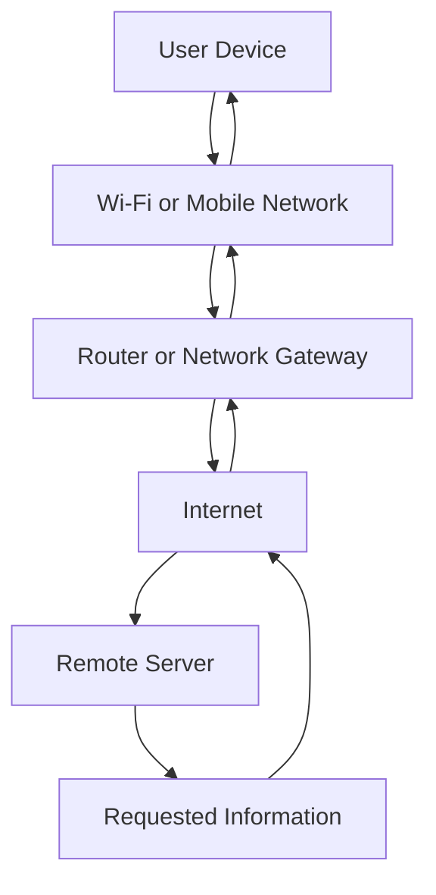

# 🌐 Networking in Everyday Life

<p align="center">
  
  
  
</p>

---

## 📌 1. Introduction

Computer networking has become an essential part of everyday life. We use networks whenever we browse the Internet, send messages, make online payments, attend virtual classes, stream videos, or communicate with other people.

Networking connects smartphones, computers, servers, and other digital devices, allowing them to exchange information and access online services.

From personal communication to large business operations, networking makes modern digital activities possible.

### 💡 Simple Example

Consider a normal day:

- You check messages on WhatsApp.
- You search for information using Google.
- You attend an online university lecture.
- You transfer money through a banking application.
- You watch videos on YouTube.
- You use GPS navigation to reach your destination.

All these activities depend on networking technologies.

---

## 📱 2. Networking in Personal Communication

Networking makes communication faster and easier by connecting people through digital platforms.

### Common Applications

- WhatsApp messaging.
- Email communication.
- Voice and video calls.
- Social media platforms.
- Online meetings.

### Real-World Example

A student in Pakistan can communicate with a friend in another country through WhatsApp or attend a video meeting using Google Meet.

### Networking Technologies Used

| Technology | Purpose |
|---|---|
| Wi-Fi | Connects devices to a wireless network |
| Mobile Networks | Provides cellular connectivity |
| Internet | Enables global communication |
| DNS | Resolves domain names |
| TCP/IP | Supports network communication |

**Importance:** Networking removes geographical communication barriers and enables instant information exchange.

---

## 🎓 3. Networking in Education

Computer networking has transformed modern education by making learning resources accessible from almost anywhere.

### Common Applications

- Online classes.
- Digital learning platforms.
- Online examinations.
- Educational websites.
- Cloud-based assignments.
- Virtual collaboration.

### Real-World Example

A university student can attend online lectures, download study materials, submit assignments, and communicate with teachers through an online learning management system.

### Networking Technologies Used

- Wi-Fi and Ethernet.
- Cloud computing.
- Web applications.
- Video conferencing.
- Client-server communication.

**Importance:** Networking makes education more accessible and supports distance learning and collaboration.

---

## 🏦 4. Networking in Banking and Finance

Banking systems depend heavily on networking to process transactions and provide digital financial services.

### Common Applications

- Online banking.
- ATM transactions.
- Mobile banking applications.
- Digital payments.
- Interbank communication.
- Financial data exchange.

### Real-World Example

When a customer withdraws money from an ATM:

1. The ATM sends a transaction request through a network.
2. The banking system receives the request.
3. The customer's account information is checked.
4. The transaction is authorized or rejected.
5. The ATM displays the result.

### Simplified ATM Communication Diagram



### Networking Technologies Used

- Secure network connections.
- Banking servers.
- Database systems.
- Encryption.
- Firewalls.
- Authentication systems.

**Importance:** Networking enables fast financial transactions and communication between banking systems.

---

## 🏥 5. Networking in Healthcare

Healthcare organizations use networking to manage medical information, support communication, and provide digital healthcare services.

### Common Applications

- Electronic Health Records (EHR).
- Online appointment systems.
- Telemedicine.
- Medical data sharing.
- Hospital management systems.
- Remote patient monitoring.

### Real-World Example

A doctor can access an authorized patient's electronic medical record through a hospital network to review previous medical information.

### Networking Technologies Used

- Hospital Local Area Networks (LANs).
- Cloud-based healthcare systems.
- Secure remote connections.
- Database servers.
- Access control systems.

**Importance:** Networking improves information accessibility and supports communication between healthcare professionals.

---

## 🛒 6. Networking in E-Commerce and Online Shopping

Online shopping platforms use computer networks to connect customers, sellers, payment systems, and delivery services.

### Common Applications

- Online shopping websites.
- Product browsing.
- Digital payments.
- Order tracking.
- Inventory management.
- Customer support.

### Real-World Example

When a customer orders shoes from an online store:

1. The customer opens the shopping website.
2. The website retrieves product information from its server.
3. The customer adds an item to the shopping cart.
4. The payment system processes the transaction.
5. The store receives the order.
6. The delivery service receives shipping information.

### E-Commerce Communication Diagram



### Networking Technologies Used

- HTTP and HTTPS.
- DNS.
- TCP/IP.
- Cloud hosting.
- Database servers.
- Secure payment connections.

**Importance:** Networking makes online shopping, digital transactions, and order management possible.

---

## 🎬 7. Networking in Entertainment and Media

Networking provides access to digital entertainment and media services through Internet connectivity.

### Common Applications

- YouTube.
- Netflix.
- Spotify.
- Online gaming.
- Live streaming.
- Music and video downloads.

### Real-World Example

When you watch a YouTube video:

1. Your device connects to the Internet.
2. Your browser or application requests the video.
3. The service identifies an appropriate content server.
4. Video data is transmitted to your device.
5. Your device buffers and plays the video.

### Networking Technologies Used

- Internet Protocol (IP).
- Content Delivery Networks (CDNs).
- Wi-Fi.
- Streaming protocols.
- TCP and QUIC-based communication.

**Importance:** Networking allows users to access entertainment content from different locations.

---

## 🚗 8. Networking in Transportation and Navigation

Modern transportation systems use networking to exchange location, traffic, and travel information.

### Common Applications

- Google Maps.
- GPS navigation applications.
- Ride-hailing services.
- Traffic monitoring.
- Vehicle tracking.
- Smart transportation systems.

### Real-World Example

When you use Google Maps:

- Your device determines its location using available location technologies, including GPS.
- The application retrieves map and traffic information over a network.
- The service calculates a route.
- Updated traffic information can help suggest alternative routes.

### Networking Technologies Used

- GPS and satellite navigation.
- Mobile networks.
- Internet connectivity.
- Location-based services.
- Cloud computing.

**Importance:** Networking supports connected transportation services and real-time information exchange.

---

## 🏠 9. Networking in Smart Homes

Smart home technologies use networking to connect household devices and enable remote monitoring and control.

### Common Applications

- Smart TVs.
- Smart security cameras.
- Smart lights.
- Smart thermostats.
- Smart speakers.
- Smart home appliances.

### Real-World Example

A homeowner can use a smartphone application to control smart lights or monitor a security camera while away from home.

### Networking Technologies Used

- Wi-Fi.
- Bluetooth.
- Zigbee.
- Thread.
- Internet of Things (IoT).

**Importance:** Networking makes home automation and connected device management possible.

---

## 🏢 10. Networking in Business and Organizations

Businesses use networking to connect employees, departments, offices, servers, and customers.

### Common Applications

- Office communication.
- Shared file systems.
- Cloud services.
- Video conferences.
- Enterprise applications.
- Centralized data management.

### Real-World Example

A company with offices in Multan, Lahore, and Karachi can connect its branches through Wide Area Network (WAN) technologies.

Employees can communicate and access authorized organizational resources across different locations.

### Networking Technologies Used

- Local Area Networks (LANs).
- Wide Area Networks (WANs).
- Virtual Private Networks (VPNs).
- Routers and switches.
- Firewalls.
- Enterprise servers.

**Importance:** Networking improves organizational communication, productivity, and resource management.

---

## 🔐 11. Networking in Cybersecurity

Networking is a fundamental part of cybersecurity because connected devices exchange information and communicate through network infrastructure.

Cybersecurity professionals use networking knowledge to monitor communication, identify threats, and protect digital resources.

### Common Applications

- Network monitoring.
- Firewall management.
- Intrusion detection.
- Traffic analysis.
- Secure remote access.
- Security incident investigation.

### Real-World Example

A Security Operations Center (SOC) analyst investigates suspicious network traffic:

1. Monitors network activity.
2. Identifies suspicious source and destination IP addresses.
3. Analyzes network packets.
4. Reviews firewall and security logs.
5. Investigates potential threats.
6. Reports or escalates security incidents.

### Important Cybersecurity Tools

| Tool | Purpose |
|---|---|
| Wireshark | Captures and analyzes network traffic |
| Nmap | Network discovery and security auditing |
| Cisco Packet Tracer | Simulates network infrastructure |
| pfSense | Firewall and network security platform |
| Snort | Network intrusion detection and prevention |
| Wazuh | Security monitoring and threat detection |

**Importance:** Networking knowledge helps cybersecurity professionals understand how attacks occur and how to protect connected systems.

---

## 📊 12. Summary: Networking in Everyday Life

| Area | Application | Networking Benefit |
|---|---|---|
| Communication | WhatsApp, Email | Instant communication |
| Education | Online classes | Remote learning |
| Banking | ATMs, Mobile Banking | Digital transactions |
| Healthcare | Telemedicine | Medical information access |
| E-Commerce | Online shopping | Digital business operations |
| Entertainment | YouTube, Netflix | Online streaming |
| Transportation | Google Maps | Navigation and traffic updates |
| Smart Homes | Smart devices | Remote device control |
| Business | Office networks | Resource sharing |
| Cybersecurity | SOC operations | Threat monitoring |

---

## 🔄 13. How Different Everyday Services Connect

Most modern digital services follow a similar communication process.

A user interacts with an application, the application communicates with a remote service, and information travels through network infrastructure.

### General Network Communication



**Explanation:**

- The user sends a request through a device.
- The device connects through a local or mobile network.
- Network infrastructure forwards the request.
- The remote server processes the request.
- The requested information is returned to the user.

*Note: This is a simplified representation. Real communication may involve DNS servers, firewalls, load balancers, CDNs, and multiple routers.*

---

## ⚠️ 14. Risks of Networking in Everyday Life

Although networking makes daily activities easier, it also introduces security and privacy risks.

### Common Risks

| Risk | Description | Protection |
|---|---|---|
| Phishing | Fake messages or websites attempt to steal information. | Verify links and website addresses. |
| Malware | Malicious software can infect connected devices. | Use updated security software. |
| Data Theft | Unauthorized parties may access sensitive information. | Use encryption and strong authentication. |
| Unsecured Wi-Fi | Weakly protected wireless networks can expose users to risks. | Use trusted, secured Wi-Fi networks. |
| Unauthorized Access | Attackers may attempt to access accounts or devices. | Use strong passwords and MFA. |
| Privacy Leakage | Applications may collect or expose personal information. | Review privacy and application permissions. |

### Basic Safety Practices

- Use strong and unique passwords.
- Enable Multi-Factor Authentication (MFA).
- Avoid suspicious links and attachments.
- Keep devices and applications updated.
- Use HTTPS websites for secure web communication.
- Secure home Wi-Fi with modern encryption.
- Avoid accessing sensitive accounts on untrusted networks.

---

## 🛠️ 15. Practical Learning Activities

Explore how networking works in everyday applications using these tools.

| Tool | Suggested Activity |
|---|---|
| Cisco Packet Tracer | Build a small home or office network. |
| Wireshark | Observe DNS, TCP, and HTTP/HTTPS-related traffic metadata. |
| Windows CMD | Test connectivity using `ping`. |
| Linux Terminal | Explore IP configuration and routing. |
| VirtualBox | Create a virtual network between two machines. |
| Nmap | Discover devices on your own authorized lab network. |

### Useful Networking Commands

**1. Check IP Configuration**

```powershell
ipconfig /all
```

**2. Test Internet Connectivity**

```powershell
ping 8.8.8.8
```

**3. Check DNS Resolution**

```powershell
nslookup google.com
```

**4. Trace the Network Route**

```powershell
tracert google.com
```

**5. Display Network Connections**

```powershell
netstat -ano
```

---

## 📝 16. Key Takeaways

- Networking is an essential part of modern everyday life.
- Smartphones use networks for communication and Internet access.
- Educational institutions use networking for online learning.
- Banks rely on networking for digital financial services.
- Hospitals use networks to exchange medical information.
- E-commerce platforms use networking to process orders and payments.
- Entertainment platforms depend on network connectivity for streaming.
- Smart homes use networking to connect and control devices.
- Businesses use networks for communication and resource sharing.
- Cybersecurity professionals use networking knowledge to protect digital systems.
- Safe network usage requires proper security practices.

---

## 🧠 17. Knowledge Check

Test your understanding of this topic:

1. How is networking used in everyday life?
2. How do messaging applications use computer networks?
3. Explain the role of networking in online education.
4. How does an ATM communicate with a bank server?
5. How is networking used in healthcare?
6. How do online shopping platforms use networking?
7. What is the role of networking in entertainment?
8. What is an IoT device? Give three examples.
9. How does networking support transportation and navigation?
10. Why is networking important in cybersecurity?
11. What are common security risks associated with everyday networking?
12. Name five networking technologies used in daily life.

---

## 📚 18. References & Further Learning

Explore these resources to improve your networking knowledge:

- [Cisco Networking Academy](https://www.netacad.com/)
- [Cisco Official Website](https://www.cisco.com/)
- [Cloudflare Learning Center](https://www.cloudflare.com/learning/)
- [Wireshark Documentation](https://www.wireshark.org/docs/)
- [Internet Society](https://www.internetsociety.org/)
- [Nmap Official Documentation](https://nmap.org/book/)

---

## 🔗 19. Related Topics

Continue exploring Networking Fundamentals:

- [What is Computer Networking?](./01-What-is-Computer-Networking.md)
- [Purpose of Networking](./02-Purpose-of-Networking.md)
- [Importance of Networking](./03-Importance-of-Networking.md)
- [Advantages and Disadvantages](./04-Advantages-and-Disadvantages.md)
- [How Computer Networks Work](./05-How-Computer-Networks-Work.md)
- [Basic Networking Terminologies](./07-Basic-Networking-Terminologies.md)

---

<p align="center">
  <b>Networking & Cybersecurity Portfolio</b>
  <br/>
  <i>Learn • Practice • Document • Improve</i>
  <br/><br/>
  ⭐ Building a strong foundation in Computer Networking and Cybersecurity.
</p>