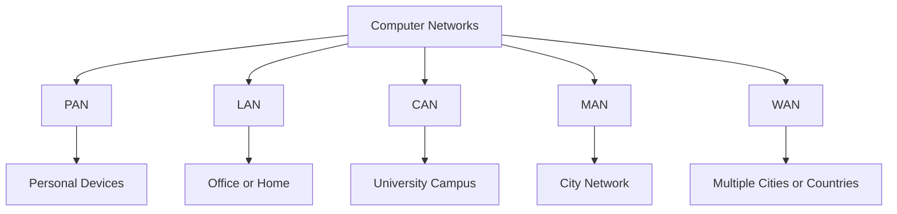
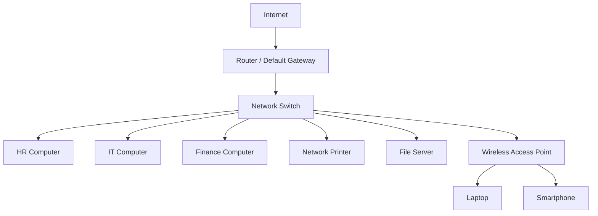

# 🌐 Basic Networking Terminologies

<p align="center">
  
  
  
</p>

---

## 📌 1. Introduction

Computer networking includes many technical terms used to describe how devices communicate, exchange data, and share resources.

Understanding these terminologies is essential for learning networking fundamentals, configuring network devices, troubleshooting connectivity issues, and developing cybersecurity skills.

This section introduces important networking terms with simple explanations and practical examples.

---

## 🖥️ 2. Basic Network Terminologies

### 1. Network

**Definition:** A network is a group of interconnected devices that communicate and share information or resources.

**Example:** Computers connected through a switch in a university computer laboratory.

### 2. Node

**Definition:** A node is any device or connection point that participates in a network.

**Examples:**
- Computer
- Laptop
- Printer
- Router
- Server

### 3. Host

**Definition:** A host is a device connected to a network that can send or receive data using network communication protocols.

**Example:** A laptop accessing a website through the Internet.

### 4. Client

**Definition:** A client is a device or application that requests services or resources from another system.

**Example:** A web browser requesting a webpage from a web server.

### 5. Server

**Definition:** A server is a computer or software system that provides services, resources, or information to clients.

**Examples:**
- Web server
- File server
- DNS server
- Email server

### 6. Peer-to-Peer (P2P)

**Definition:** A networking model in which devices can communicate and share resources directly without relying entirely on a dedicated central server.

**Example:** Two computers sharing files directly over a local network.

### 7. Network Interface Card (NIC)

**Definition:** A Network Interface Card is a hardware component that enables a device to connect to a network.

**Example:** An Ethernet port or wireless network adapter in a laptop.

---

## 🌍 3. Types of Computer Networks

Network types are commonly classified according to their geographical coverage and purpose.

| Term | Full Form | Definition |
|---|---|---|
| PAN | Personal Area Network | Connects personal devices over a short distance. |
| LAN | Local Area Network | Connects devices within a limited geographical area. |
| WLAN | Wireless Local Area Network | A LAN that uses wireless communication, commonly Wi-Fi. |
| CAN | Campus Area Network | Connects multiple LANs across a campus or organization. |
| MAN | Metropolitan Area Network | Connects networks across a city or metropolitan area. |
| WAN | Wide Area Network | Connects networks over large geographical distances. |

### Network Types Diagram



### Real-World Examples

- **PAN:** Smartphone connected to wireless earbuds through Bluetooth.
- **LAN:** Computers connected in an office.
- **WLAN:** Devices connected through home Wi-Fi.
- **CAN:** Buildings connected across a university campus.
- **MAN:** Networks connecting locations across a city.
- **WAN:** A company connecting branches in different countries.

---

## 🏷️ 4. Addressing Terminologies

Network devices need addressing information to communicate with other devices.

### 1. IP Address

**Definition:** An Internet Protocol (IP) address is a logical address assigned to a network interface for identification and communication at the network layer.

**Example:**

```text
192.168.1.10
```

**Types:**
- IPv4
- IPv6

### 2. MAC Address

**Definition:** A Media Access Control (MAC) address is a link-layer address associated with a network interface.

**Example:**

```text
00:1A:2B:3C:4D:5E
```

Switches commonly use MAC address tables to forward Ethernet frames within a local network.

### 3. Subnet Mask

**Definition:** A subnet mask identifies which part of an IPv4 address represents the network portion and which part represents the host portion.

**Example:**

```text
IP Address:  192.168.1.10
Subnet Mask: 255.255.255.0
```

### 4. Default Gateway

**Definition:** A default gateway is the next-hop device, commonly a router, that a host uses to send traffic to destinations outside its local network when no more specific route is available.

**Example:**

```text
192.168.1.1
```

### 5. DNS

**Full Form:** Domain Name System

**Definition:** DNS translates domain names into IP addresses so devices can locate services on a network.

**Example:**

```text
google.com → IP Address
```

### 6. DHCP

**Full Form:** Dynamic Host Configuration Protocol

**Definition:** DHCP automatically provides network configuration information, such as IP addresses, subnet masks, default gateways, and DNS server addresses.

**Example:** Your home router automatically assigns an IP address to your smartphone when it connects to Wi-Fi.

### 7. Port Number

**Definition:** A port number identifies a specific application or service endpoint on a device using transport-layer protocols such as TCP and UDP.

**Common Examples:**

| Port | Protocol/Service | Purpose |
|---|---|---|
| 20/21 | FTP | File transfer |
| 22 | SSH | Secure remote access |
| 23 | Telnet | Remote terminal access |
| 25 | SMTP | Email transmission |
| 53 | DNS | Domain name resolution |
| 67/68 | DHCP | Dynamic IP configuration |
| 80 | HTTP | Web communication |
| 443 | HTTPS | Secure web communication |

---

## 🔌 5. Networking Devices Terminologies

Networking devices perform different functions to connect systems and transfer information.

| Device | Definition | Main Function |
|---|---|---|
| Router | Connects different IP networks. | Forwards packets between networks. |
| Switch | Connects devices within a LAN. | Forwards frames using MAC addresses. |
| Hub | A basic physical-layer networking device. | Repeats incoming signals to other ports. |
| Modem | Converts signals for certain communication technologies. | Enables connectivity over supported ISP access networks. |
| Access Point (AP) | Provides wireless network access. | Connects Wi-Fi devices to a network. |
| Firewall | A network security device or software. | Filters traffic according to security policies. |
| Repeater | Regenerates or repeats signals. | Extends signal reach. |
| Bridge | Connects LAN segments. | Forwards frames at the data link layer. |
| Server | Provides network services. | Delivers resources to clients. |
| NIC | Network Interface Card. | Provides network connectivity to a device. |

### Router vs. Switch

| Router | Switch |
|---|---|
| Connects different networks. | Connects devices within a LAN. |
| Uses IP addressing and routing information. | Uses MAC address tables for frame forwarding. |
| Commonly operates at Layer 3. | Commonly operates at Layer 2. |
| Forwards packets. | Forwards frames. |

---

## 📡 6. Network Communication Terminologies

### 1. Bandwidth

**Definition:** Bandwidth is the maximum data transfer capacity of a network connection over a given period.

**Example:** A connection with a bandwidth of 100 Mbps.

### 2. Throughput

**Definition:** Throughput is the actual rate at which data is successfully transferred across a network.

**Example:** A 100 Mbps connection delivering 85 Mbps of actual throughput.

### 3. Latency

**Definition:** Latency is the time taken for data to travel from a source to a destination.

**Example:** A 20 ms network response time.

### 4. Jitter

**Definition:** Jitter is the variation in packet delay over time.

**Example:** Inconsistent packet arrival times during a voice or video call.

### 5. Packet Loss

**Definition:** Packet loss occurs when transmitted packets fail to reach their intended destination.

**Example:** Missing packets can cause interruptions during an online meeting.

### 6. Ping

**Definition:** Ping is a network utility that tests reachability by sending ICMP Echo Requests and receiving Echo Replies when the destination responds.

**Command:**

```bash
ping 8.8.8.8
```

### 7. Protocol

**Definition:** A protocol is a set of rules that controls communication and data exchange between network devices.

**Examples:** TCP, UDP, IP, HTTP, HTTPS, DNS, and DHCP.

### 8. Packet

**Definition:** A packet is a unit of data at the network layer, containing information such as source and destination IP addresses.

### 9. Frame

**Definition:** A frame is a data unit at the data link layer, commonly containing MAC addressing and error-detection information.

### 10. Encapsulation

**Definition:** Encapsulation is the process of adding protocol information to data as it moves through networking layers before transmission.

### 11. Decapsulation

**Definition:** Decapsulation is the process of receiving and processing protocol information to recover the original data.

---

## 🧱 7. Network Architecture Terminologies

### 1. Topology

**Definition:** Network topology describes how devices and connections are arranged in a network, physically or logically.

**Common Types:**
- Bus Topology
- Star Topology
- Ring Topology
- Mesh Topology
- Tree Topology
- Hybrid Topology

### 2. Backbone

**Definition:** A backbone is a high-capacity network infrastructure that connects different network segments or smaller networks.

### 3. VLAN

**Full Form:** Virtual Local Area Network

**Definition:** A VLAN logically divides a switched network into separate Layer 2 broadcast domains.

**Example:** An organization can separate HR, IT, and Finance devices into different VLANs.

### 4. Subnetting

**Definition:** Subnetting is the process of dividing an IP network into smaller logical networks called subnets.

**Benefit:** It helps organize IP addressing and manage network traffic.

### 5. Routing

**Definition:** Routing is the process of selecting paths and forwarding packets between different networks.

### 6. Switching

**Definition:** Switching is the process of forwarding frames within a network, commonly using MAC address information.

### 7. Broadcast Domain

**Definition:** A broadcast domain is a logical network area in which a Layer 2 broadcast frame can be received by devices within that domain.

### 8. Collision Domain

**Definition:** A collision domain is a network segment in which simultaneous transmissions can collide. In modern switched Ethernet, each switch port typically forms a separate collision domain.

---

## 🔄 8. Network Models and Protocol Terminologies

### 1. OSI Model

**Full Form:** Open Systems Interconnection

**Definition:** The OSI model is a seven-layer conceptual framework used to understand network communication.

| Layer | Name |
|---|---|
| 7 | Application |
| 6 | Presentation |
| 5 | Session |
| 4 | Transport |
| 3 | Network |
| 2 | Data Link |
| 1 | Physical |

### 2. TCP/IP Model

**Definition:** The TCP/IP model describes network communication through four commonly identified layers.

| Layer | Main Function |
|---|---|
| Application | Provides application-level network services. |
| Transport | Provides end-to-end transport services. |
| Internet | Handles IP addressing and packet forwarding. |
| Network Access | Handles local network access and transmission. |

### 3. TCP

**Full Form:** Transmission Control Protocol

**Definition:** TCP is a connection-oriented transport protocol that provides reliable, ordered data delivery.

### 4. UDP

**Full Form:** User Datagram Protocol

**Definition:** UDP is a connectionless transport protocol that provides low-overhead data transmission without guaranteeing delivery or ordering.

### 5. HTTP

**Full Form:** Hypertext Transfer Protocol

**Definition:** HTTP is an application-layer protocol used to transfer web resources.

### 6. HTTPS

**Full Form:** Hypertext Transfer Protocol Secure

**Definition:** HTTPS is HTTP communication secured using TLS.

### 7. FTP

**Full Form:** File Transfer Protocol

**Definition:** FTP is an application-layer protocol used for transferring files.

### 8. SSH

**Full Form:** Secure Shell

**Definition:** SSH provides secure remote access to supported systems and network devices.

---

## 🛡️ 9. Network Security Terminologies

Networking and cybersecurity are closely connected. The following terms are important for understanding network protection.

| Term | Definition |
|---|---|
| Firewall | Filters network traffic according to security rules. |
| VPN | Creates a virtual private connection over another network, commonly using encryption. |
| IDS | Intrusion Detection System; monitors activity for suspicious behavior. |
| IPS | Intrusion Prevention System; detects and can block malicious activity. |
| Encryption | Converts readable information into a protected form. |
| Authentication | Verifies the identity of a user or device. |
| Authorization | Determines what an authenticated user or device is allowed to access. |
| Malware | Software designed to perform malicious activities. |
| Phishing | A deceptive technique used to trick people into revealing information or taking unsafe actions. |
| DoS | Denial-of-Service attack intended to disrupt service availability. |
| DDoS | Distributed Denial-of-Service attack using multiple sources. |
| Network Segmentation | Divides a network into separate sections to control communication and access. |

### Why These Terms Matter

These concepts are frequently used in:

- SOC monitoring and incident investigation.
- Network security administration.
- Firewall configuration.
- Penetration testing.
- Network troubleshooting.
- Security operations.

---

## 🏢 10. Real-World Example: Understanding a Small Office Network

Consider an office with several employees, a printer, and a central server.



### Networking Terms in This Example

| Term | Example in the Office |
|---|---|
| LAN | The office internal network. |
| Router | Connects the office LAN to external networks. |
| Switch | Connects wired office devices. |
| Server | Stores shared company files. |
| Client | Employee computer requesting a file. |
| IP Address | Identifies a device's network interface. |
| MAC Address | Identifies a device's link-layer interface. |
| DHCP | Provides automatic IP configuration. |
| DNS | Resolves internal or external domain names. |
| Default Gateway | Provides the next hop to other networks. |
| Firewall | Applies network traffic security rules. |
| VLAN | Separates departments into logical networks. |

---

## 🛠️ 11. Practical Networking Commands

Use these commands to explore networking information on your own computer.

### Windows Commands

**1. View IP Configuration**

```powershell
ipconfig
```

**2. View Detailed Network Configuration**

```powershell
ipconfig /all
```

**3. Test Network Connectivity**

```powershell
ping 8.8.8.8
```

**4. Display Network Route**

```powershell
tracert google.com
```

**5. Check DNS Resolution**

```powershell
nslookup google.com
```

**6. Display MAC Address Information**

```powershell
getmac
```

**7. Display Network Connections**

```powershell
netstat -ano
```

### Linux Commands

```bash
ip addr
ip route
ip link
ping -c 4 8.8.8.8
traceroute google.com
nslookup google.com
```

### Suggested Practical Activities

1. Find your computer's IPv4 address.
2. Identify your default gateway.
3. Find your network adapter's MAC address.
4. Check DNS resolution for a website.
5. Test connectivity using `ping`.
6. View the route to a destination.
7. Build a small LAN in Cisco Packet Tracer.
8. Configure IP addresses and test communication.

---

## 📊 12. Quick Revision Table

| Category | Important Terms |
|---|---|
| Basic Concepts | Network, Node, Host, Client, Server |
| Network Types | PAN, LAN, WLAN, CAN, MAN, WAN |
| Addressing | IP Address, MAC Address, Subnet Mask |
| Network Configuration | DHCP, DNS, Default Gateway |
| Devices | Router, Switch, Hub, Modem, Access Point |
| Communication | Bandwidth, Throughput, Latency, Jitter |
| Data Units | Data, Segment, Packet, Frame, Bits |
| Architecture | Topology, VLAN, Subnetting, Routing |
| Models | OSI Model, TCP/IP Model |
| Protocols | TCP, UDP, HTTP, HTTPS, FTP, SSH |
| Security | Firewall, VPN, IDS, IPS, Encryption |

---

## 📝 13. Key Takeaways

- A network connects devices for communication and resource sharing.
- A host is a network-connected device that can communicate using network protocols.
- LAN, WAN, MAN, and PAN describe different network coverage areas.
- IP addresses provide logical addressing.
- MAC addresses support link-layer communication.
- Routers connect different networks, while switches connect devices within a LAN.
- DNS resolves domain names, while DHCP provides automatic network configuration.
- Bandwidth describes capacity, while throughput describes actual data transfer.
- Latency measures delay, and jitter measures variation in delay.
- VLANs logically separate Layer 2 broadcast domains.
- The OSI and TCP/IP models help explain network communication.
- Network security terms are essential for protecting connected systems.

---

## 🧠 14. Knowledge Check

Test your understanding of this topic:

1. What is a computer network?
2. What is the difference between a node and a host?
3. Explain the difference between a client and a server.
4. What are PAN, LAN, MAN, and WAN?
5. What is the purpose of an IP address?
6. What is a MAC address?
7. What is the function of a subnet mask?
8. What is a default gateway?
9. What are DNS and DHCP?
10. What is the difference between a router and a switch?
11. Explain bandwidth, throughput, and latency.
12. What is packet loss?
13. What is a VLAN?
14. What is subnetting?
15. What is the difference between TCP and UDP?
16. What is the purpose of a firewall?
17. What is the difference between IDS and IPS?
18. What is network segmentation?

---

## 📚 15. References & Further Learning

Explore these resources to strengthen your networking knowledge:

- [Cisco Networking Academy](https://www.netacad.com/)
- [Cisco Official Website](https://www.cisco.com/)
- [Cloudflare Learning Center](https://www.cloudflare.com/learning/)
- [Wireshark Documentation](https://www.wireshark.org/docs/)
- [RFC Editor](https://www.rfc-editor.org/)
- [Nmap Official Documentation](https://nmap.org/book/)

---

## 🔗 16. Related Topics

Continue exploring Networking Fundamentals:

- [What is Computer Networking?](./01-What-is-Computer-Networking.md)
- [Purpose of Networking](./02-Purpose-of-Networking.md)
- [Importance of Networking](./03-Importance-of-Networking.md)
- [Advantages and Disadvantages](./04-Advantages-and-Disadvantages.md)
- [How Computer Networks Work](./05-How-Computer-Networks-Work.md)
- [Networking in Everyday Life](./06-Networking-in-Everyday-Life.md)

---

<p align="center">
  <b>Networking & Cybersecurity Portfolio</b>
  <br/>
  <i>Learn • Practice • Document • Improve</i>
  <br/><br/>
  ⭐ Building a strong foundation in Computer Networking and Cybersecurity.
</p>

