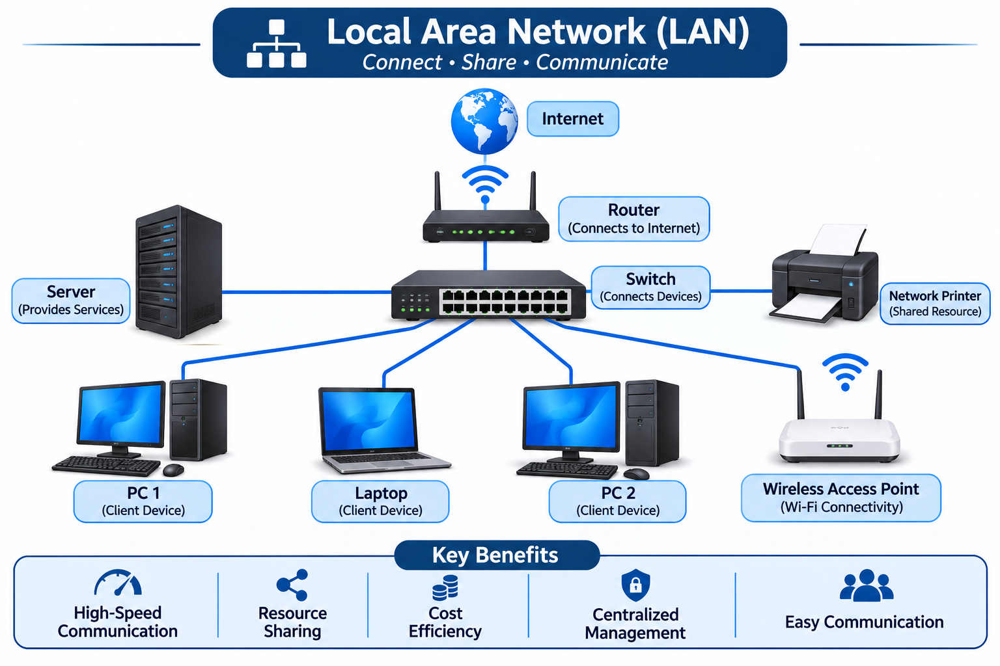

# 🌐 Local Area Network (LAN)

\<p align="center">
&#x20; \
&#x20; \
&#x20; \
\</p>

## 📌 Overview

A **Local Area Network (LAN)** is a computer network that connects multiple devices within a limited geographical area, such as a home, office, school, university, or computer laboratory.

It allows connected devices to communicate, exchange data, share resources, and access network services.

LANs commonly use Ethernet cables and network switches for wired connectivity, while wireless LANs use Wi-Fi access points to connect devices without physical cables.

A LAN is generally owned, managed, and maintained by an individual, organization, or institution.

Local Area Networks play an important role in modern networking because they provide reliable communication and resource sharing within a specific location.

---

## 🎯 Purpose of LAN

The primary purpose of a Local Area Network is to connect devices within a limited geographical area and enable efficient communication and resource sharing.

Its main purposes include:

- Connecting multiple computers and devices.
- Sharing files and information.
- Sharing printers and other hardware resources.
- Providing access to centralized servers.
- Enabling communication between connected devices.
- Sharing an internet connection.
- Supporting centralized network administration.
- Providing connectivity for organizational operations.

---

## ⚙️ How LAN Works

A Local Area Network works by connecting multiple devices through networking equipment such as switches, routers, and wireless access points.

In a typical Ethernet LAN, devices communicate using network interfaces and MAC addresses. Switches forward Ethernet frames to the appropriate devices within the local network.

Routers connect different IP networks and provide communication between the LAN and external networks, such as the internet.

## 🖼️ LAN Network Diagram

The following diagram illustrates a typical Local Area Network (LAN), showing how computers, servers, printers, and wireless devices communicate through network switches and routers.

<p align="center">
  
</p>

<p align="center">
  <i>Figure 1: Basic Local Area Network (LAN) Architecture</i>
</p>

### Basic Working Process

1. **Device Connection:** Computers and other devices connect to the network through Ethernet cables or Wi-Fi.
2. **IP Address Assignment:** Devices receive IP addresses through DHCP or manual configuration.
3. **Data Transmission:** Devices send information in the form of network packets and frames.
4. **Switching:** Network switches forward Ethernet frames based on their MAC address tables.
5. **Routing:** Routers forward traffic between different IP networks.
6. **Communication:** Connected devices exchange information and access shared resources.

---

## 🧩 Components of LAN

A Local Area Network consists of several hardware and software components.

| Component                    | Description                                                          |
| ---------------------------- | -------------------------------------------------------------------- |
| Computers / Hosts            | End devices that communicate over the network.                       |
| Network Switch               | Connects multiple devices within a LAN and forwards Ethernet frames. |
| Router                       | Connects different networks and forwards IP packets.                 |
| Wireless Access Point        | Provides wireless connectivity to network devices.                   |
| Network Interface Card (NIC) | Enables a device to connect to a network.                            |
| Ethernet Cable               | Provides wired network connectivity.                                 |
| Server                       | Provides centralized services, files, applications, and resources.   |
| Network Printer              | Allows multiple users to share printing resources.                   |

---

## 📡 Technologies Used in LAN

LANs use different networking technologies to establish communication between connected devices.

| Technology | Description                                                     | Example                          |
| ---------- | --------------------------------------------------------------- | -------------------------------- |
| Ethernet   | Standard technology for wired local area networking.            | Office computer network          |
| Wi-Fi      | Wireless technology used to connect devices to a local network. | Home Wi-Fi                       |
| TCP/IP     | Protocol suite used for communication between network devices.  | Computer-to-server communication |
| VLAN       | Logically separates a LAN into different broadcast domains.     | Separating HR and IT departments |
| DHCP       | Automatically assigns IP configuration to network devices.      | Automatic IP assignment          |
| DNS        | Translates domain names into IP addresses.                      | Resolving a website name         |

---

## 🏢 Types of LAN

Local Area Networks can be implemented using different connectivity approaches.

### 1. Wired LAN

A Wired LAN connects devices using physical network cables, typically Ethernet cables.

**Characteristics:**

- Uses physical network connections.
- Commonly uses switches.
- Provides reliable connectivity.
- Suitable for offices, laboratories, and data centers.

**Example:** Computers connected to an Ethernet switch in an office.

### 2. Wireless LAN (WLAN)

A Wireless LAN connects devices using wireless communication technologies, primarily Wi-Fi.

**Characteristics:**

- Uses wireless access points.
- Reduces the need for physical network cables.
- Supports mobile devices.
- Requires appropriate wireless security configurations.

**Example:** Smartphones and laptops connected to a home Wi-Fi network.

---

## 🏠 Real-World Examples of LAN

Local Area Networks are widely used in different environments.

### 1. Home Network

A home router connects smartphones, laptops, smart TVs, and other devices to a local network.

### 2. Office Network

An organization connects employee computers, printers, and servers to share resources and communicate.

### 3. University Computer Laboratory

Multiple computers are connected through network switches to access educational resources and centralized services.

### 4. Hospital Network

Computers, medical systems, and authorized devices communicate through an organizational network.

### 5. Bank Branch Network

Employee workstations and local servers communicate within a branch network to support internal operations.

---

## 📊 Characteristics of LAN

| Characteristic | Description                                                             |
| -------------- | ----------------------------------------------------------------------- |
| Coverage Area  | Limited geographical area, such as a building or office.                |
| Ownership      | Usually privately owned and managed.                                    |
| Speed          | Common Ethernet speeds include 100 Mbps, 1 Gbps, and 10 Gbps or higher. |
| Connectivity   | Wired or wireless.                                                      |
| Data Transfer  | Supports communication and resource sharing between connected devices.  |
| Infrastructure | Uses switches, routers, access points, and network cables.              |
| Cost           | Depends on network size and required equipment.                         |
| Administration | Generally managed by an individual or organization.                     |
| Reliability    | Can provide reliable connectivity with proper design and maintenance.   |

---

## ✅ Advantages of LAN

1. **High-Speed Communication:** Supports fast data transfer between connected devices.
2. **Resource Sharing:** Allows multiple users to share printers, files, and other resources.
3. **Cost Efficiency:** Reduces the need for separate hardware and resources for every user.
4. **Centralized Management:** Network administrators can manage users, devices, and resources.
5. **Easy Communication:** Enables efficient communication between computers and servers.
6. **Data Management:** Supports centralized storage and backup solutions.
7. **Scalability:** Additional devices can be connected as organizational requirements grow.

---

## ❌ Disadvantages of LAN

1. **Limited Coverage:** A LAN generally covers a relatively small geographical area.
2. **Initial Setup Cost:** Requires networking equipment, cables, and configuration.
3. **Maintenance:** Requires regular monitoring and technical maintenance.
4. **Security Risks:** Poorly configured networks may allow unauthorized access.
5. **Network Dependency:** Equipment failures can interrupt connectivity.
6. **Administration:** Larger LANs require skilled network administrators.
7. **Malware Spread:** Inadequate security controls can allow malware to spread between connected systems.

---

## 🔐 LAN Security Considerations

Network security is essential for protecting Local Area Networks from unauthorized access, attacks, and data breaches.

Important security practices include:

- Configure strong passwords on network devices.
- Implement VLANs for network segmentation.
- Use access control lists (ACLs) where appropriate.
- Enable port security on managed switches.
- Use WPA2 or WPA3 security for wireless networks.
- Keep routers, switches, and access points updated.
- Monitor network traffic for suspicious activities.
- Disable unused switch ports.
- Implement firewall protection.
- Maintain regular backups of important network configurations.

### Common LAN Security Threats

| Security Threat     | Description                                                                                            |
| ------------------- | ------------------------------------------------------------------------------------------------------ |
| MAC Flooding        | An attack that attempts to overwhelm a switch's MAC address table.                                     |
| ARP Spoofing        | An attacker sends forged ARP messages to associate their MAC address with another device's IP address. |
| MAC Spoofing        | An attacker changes a device's MAC address to impersonate another device.                              |
| VLAN Hopping        | An attack that attempts to gain access to traffic in another VLAN.                                     |
| Unauthorized Access | An unauthorized user gains access to network resources.                                                |
| Malware Propagation | Malicious software spreads between connected devices.                                                  |

---

## 🆚 LAN vs PAN

| Feature        | PAN                       | LAN                                                  |
| -------------- | ------------------------- | ---------------------------------------------------- |
| Full Form      | Personal Area Network     | Local Area Network                                   |
| Coverage       | Around an individual      | Home, office, or building                            |
| Range          | Very short                | Larger than PAN                                      |
| Ownership      | Generally individual      | Individual or organization                           |
| Connectivity   | Wired or wireless         | Wired or wireless                                    |
| Infrastructure | Minimal                   | Switches, routers, and access points may be required |
| Example        | Smartphone and smartwatch | Office computer network                              |

---

## 🧠 Key Takeaways

- LAN stands for Local Area Network.
- It connects devices within a limited geographical area.
- LANs are commonly used in homes, offices, schools, and organizations.
- Ethernet is a widely used wired LAN technology.
- Wi-Fi enables wireless local area networking.
- Switches connect devices within an Ethernet LAN.
- Routers connect different IP networks.
- LANs support file sharing, resource sharing, and communication.
- Network segmentation and access control help improve LAN security.

---

## 🛠️ Practical Learning

To understand LAN practically, perform the following activities using **Cisco Packet Tracer**:

### Lab 01 — Basic LAN Connectivity

- Add two PCs and one network switch.
- Connect both PCs to the switch using Copper Straight-Through cables.
- Assign IP addresses to both computers within the same subnet.
- Use the `ping` command to test connectivity.
- Observe successful communication between both devices.

### Lab 02 — Build a Small Office LAN

- Add four PCs and one network switch.
- Connect all PCs to the switch.
- Configure IP addresses.
- Test communication using ping.
- Inspect the switch MAC address table using:

```bash
show mac address-table
```

### Lab 03 — LAN Troubleshooting

Practice the following commands:

| Command                  | Purpose                                           |
| ------------------------ | ------------------------------------------------- |
| `ipconfig`               | Displays IP configuration on Windows.             |
| `ping`                   | Tests connectivity between devices.               |
| `ipconfig /all`          | Displays detailed network configuration.          |
| `arp -a`                 | Displays the ARP cache.                           |
| `tracert`                | Traces the route to a destination on Windows.     |
| `show mac address-table` | Displays learned MAC addresses on a Cisco switch. |

**Practical Objective:** Understand how devices connect through a network switch, communicate using IP addresses, and exchange Ethernet frames within a LAN.

---

## 📚 Learning References

- [Cisco Networking Academy](https://www.netacad.com/)
- [Cisco Official Website](https://www.cisco.com/)
- [Cloudflare Learning Center](https://www.cloudflare.com/learning/)
- [Wireshark Documentation](https://www.wireshark.org/docs/)
- [IEEE 802.3 Ethernet Working Group](https://www.ieee802.org/3/)

---

## 🔗 Related Topics

- [Types of Computer Networks](./README.md)
- [Personal Area Network (PAN)](./01-Personal-Area-Network-PAN.md)
- [Wireless Local Area Network (WLAN)](./03-Wireless-Local-Area-Network-WLAN.md)
- [Campus Area Network (CAN)](./04-Campus-Area-Network-CAN.md)
- [Network Topologies](../03-Network-Topologies/)
- [OSI Model](../04-OSI-Model/)

---

\<p align="center">   \<b>Networking & Cybersecurity Portfolio\</b>   \<br/>   \<i>Learn • Practice • Document • Improve\</i> \</p>

\<p align="center">   ⭐ Building a strong foundation for a career in Networking and Cybersecurity. \</p>
