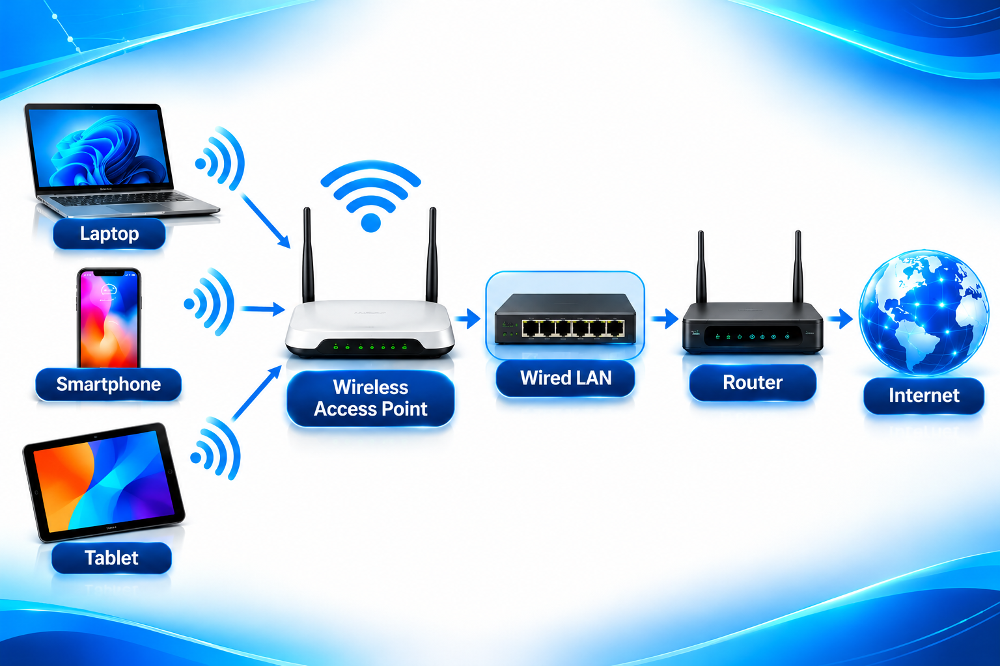
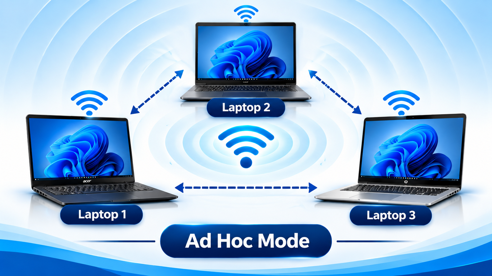
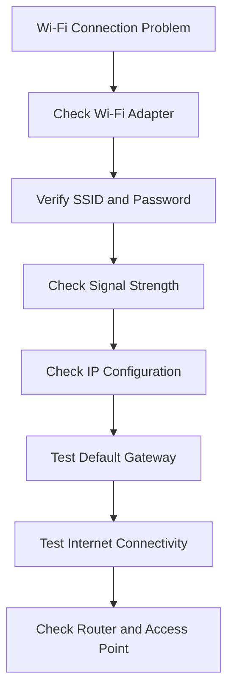
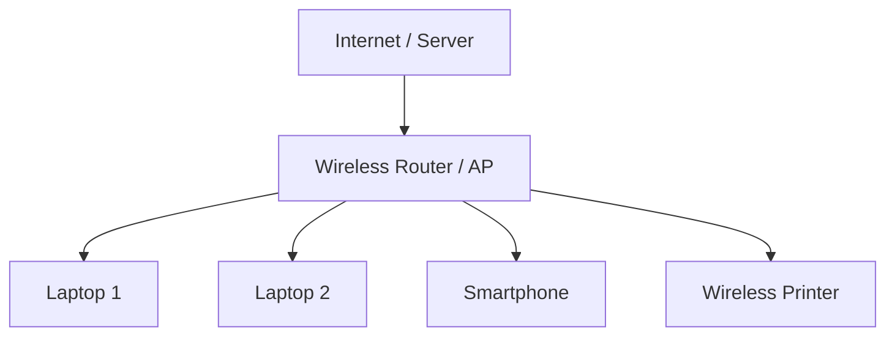

# 📡 Wireless Local Area Network (WLAN)

<p align="center">
  
  
  
</p>

---

## 📌 1. Introduction

A **Wireless Local Area Network (WLAN)** is a type of Local Area Network (LAN) that connects devices wirelessly within a limited geographical area using radio waves.

Unlike traditional wired LANs, which use Ethernet cables, WLAN allows devices such as laptops, smartphones, tablets, and printers to communicate without requiring physical network cables.

WLANs commonly use **Wi-Fi technology**, based on the IEEE 802.11 family of wireless networking standards.

**In simple words:** WLAN is a local network that allows devices to connect and communicate wirelessly, usually through Wi-Fi.

### 💡 Real-World Examples

- Home Wi-Fi networks.
- University campus Wi-Fi.
- Office wireless networks.
- Coffee shop public Wi-Fi.
- Wireless networks in hotels and hospitals.

---

## 🎯 2. Purpose of WLAN

The main purpose of WLAN is to provide wireless network connectivity and allow devices to communicate and share resources within a limited area.

### Main Purposes

1. **Wireless Connectivity:** Connect devices without physical Ethernet cables.
2. **Mobility:** Allow users to move within the wireless coverage area while maintaining connectivity.
3. **Resource Sharing:** Access shared printers, files, and network services.
4. **Internet Access:** Connect wireless devices to the Internet through a router or network gateway.
5. **Flexible Expansion:** Add new wireless devices without installing individual network cables.
6. **Convenience:** Provide network access to mobile devices such as smartphones and tablets.

---

## ⚙️ 3. How WLAN Works

WLAN uses radio signals to transmit and receive data between wireless devices.

A wireless access point (AP) provides connectivity between wireless clients and the network. In many home networks, the wireless access point is integrated into the Wi-Fi router.

### Basic Working Process

1. **Wireless Signal Broadcasting:** The access point broadcasts a wireless network name, known as an SSID.
2. **Network Discovery:** Wireless devices scan for available Wi-Fi networks.
3. **Network Selection:** The user selects the desired wireless network.
4. **Authentication:** The device completes the required security authentication.
5. **Connection Establishment:** The device associates with the wireless access point.
6. **IP Configuration:** The device receives network configuration, commonly through DHCP.
7. **Data Communication:** The device sends and receives data through the wireless network.

---

## 📊 WLAN Network Diagram

The following diagram illustrates how wireless devices connect to a Local Area Network (LAN) through a Wireless Access Point or Wireless Router.

<p align="center">
  
</p>

### How to Understand the Diagram

1. **Internet:** Provides access to external networks and online services.
2. **Wireless Router / Access Point:** Provides wireless connectivity to nearby devices.
3. **Wireless Signals:** Carry data between the access point and connected devices.
4. **Client Devices:** Laptops, smartphones, tablets, printers, and smart TVs connect wirelessly.
5. **Frequency Bands:** WLAN commonly operates using 2.4 GHz, 5 GHz, and 6 GHz bands, depending on device and access point support.

### Key Components

| Component | Function |
|---|---|
| Wireless Router | Connects the local network to the Internet and may provide Wi-Fi access. |
| Access Point (AP) | Allows wireless devices to connect to a wired network. |
| Wireless NIC | Enables a device to communicate over Wi-Fi. |
| SSID | The name used to identify a wireless network. |
| Wi-Fi | A family of wireless networking technologies based on IEEE 802.11 standards. |

> **Key Point:** WLAN allows devices to communicate over a local network without requiring a physical Ethernet connection to every device.

---

*Illustration: Wireless devices connect to an access point, which provides access to the network.*

---

## 🧩 4. Main Components of WLAN

A WLAN consists of different hardware and networking components that work together to provide wireless connectivity.

| Component | Description | Function |
|---|---|---|
| Wireless Access Point (AP) | Device that provides wireless network access. | Connects wireless clients to a network. |
| Wireless Router | Router with wireless access point functionality. | Provides Wi-Fi and routing capabilities. |
| Wireless NIC | Wireless Network Interface Card. | Allows a device to connect to Wi-Fi. |
| Antenna | Component used to transmit and receive radio signals. | Supports wireless communication. |
| Wireless Client | Device connected to a WLAN. | Sends and receives network data. |
| Modem | Device used for supported ISP access technologies. | Provides connectivity to an ISP network. |
| DHCP Server | Provides automatic network configuration. | Assigns IP addresses and other settings. |

### Example: Home WLAN

A typical home wireless network may contain:

- One Wi-Fi router.
- Two laptops.
- Three smartphones.
- One smart TV.
- One wireless printer.

All these devices can communicate through the wireless network, depending on its configuration and access permissions.

---

## 📶 5. What Is Wi-Fi?

**Wi-Fi** is a wireless networking technology that allows electronic devices to connect to a local network using radio waves.

It is commonly used to implement WLANs.

Wi-Fi technology follows IEEE 802.11 wireless networking standards.

### Common Wi-Fi Standards

| Standard | Wi-Fi Generation | Frequency Bands | General Characteristics |
|---|---|---|---|
| IEEE 802.11b | Wi-Fi 1 (legacy) | 2.4 GHz | Early wireless networking standard. |
| IEEE 802.11a | Legacy | 5 GHz | Introduced higher-frequency wireless communication. |
| IEEE 802.11g | Legacy | 2.4 GHz | Improved performance over 802.11b. |
| IEEE 802.11n | Wi-Fi 4 | 2.4 / 5 GHz | Introduced MIMO support. |
| IEEE 802.11ac | Wi-Fi 5 | 5 GHz | Improved wireless throughput. |
| IEEE 802.11ax | Wi-Fi 6 / 6E | 2.4 / 5 / 6 GHz* | Improved efficiency in high-density environments. |
| IEEE 802.11be | Wi-Fi 7 | 2.4 / 5 / 6 GHz* | Supports higher performance and Multi-Link Operation. |

*Note: Availability of frequency bands depends on the standard, device capabilities, regulatory requirements, and country.*

---

## 📡 6. WLAN Frequency Bands

Wireless networks commonly operate using different radio frequency bands.

### A. 2.4 GHz Band

The 2.4 GHz band provides relatively broad coverage and generally better penetration through walls than higher-frequency bands.

**Characteristics:**
- Longer coverage range in many environments.
- Better wall penetration compared with 5 GHz and 6 GHz.
- More susceptible to interference from other devices.
- Commonly used by older Wi-Fi devices and IoT equipment.

### B. 5 GHz Band

The 5 GHz band supports wider channels and generally offers higher potential speeds in suitable conditions.

**Characteristics:**
- Higher potential throughput.
- More available channels than 2.4 GHz in many regulatory domains.
- Typically shorter range than 2.4 GHz.
- Often experiences less congestion than 2.4 GHz.

### C. 6 GHz Band

The 6 GHz band provides additional spectrum for supported Wi-Fi technologies, including Wi-Fi 6E and Wi-Fi 7.

**Characteristics:**
- Additional wireless channels.
- Supports high-performance wireless connectivity.
- Requires compatible devices and access points.
- Availability depends on local regulations.

### Frequency Band Comparison

| Feature | 2.4 GHz | 5 GHz | 6 GHz |
|---|---|---|---|
| Coverage | Generally wider | Generally shorter | Generally shorter |
| Wall Penetration | Better | Moderate | Generally lower |
| Potential Speed | Lower | Higher | Higher |
| Interference | Often more crowded | Often less crowded | Depends on environment |
| Common Use | General connectivity and IoT | High-speed Wi-Fi | Modern high-performance Wi-Fi |

---

## 🏷️ 7. Important WLAN Terminologies

Understanding wireless networking requires familiarity with several technical terms.

| Term | Full Form / Meaning | Description |
|---|---|---|
| SSID | Service Set Identifier | Name of a wireless network. |
| BSSID | Basic Service Set Identifier | Identifies a specific wireless basic service set, commonly using the AP radio's MAC address. |
| AP | Access Point | Provides wireless connectivity to clients. |
| WLAN | Wireless Local Area Network | A local network using wireless communication. |
| Wi-Fi | Wireless networking technology | Enables wireless network connectivity. |
| RSSI | Received Signal Strength Indicator | Indicates received signal strength. |
| Channel | Radio channel | A portion of wireless frequency spectrum used for communication. |
| Roaming | Wireless roaming | Moving between access points while maintaining network connectivity. |
| WPA2 | Wi-Fi Protected Access 2 | Wireless security protocol. |
| WPA3 | Wi-Fi Protected Access 3 | Newer Wi-Fi security protocol. |
| MIMO | Multiple Input Multiple Output | Uses multiple antennas for wireless communication. |
| MU-MIMO | Multi-User MIMO | Allows supported APs to communicate with multiple clients simultaneously. |

### SSID Example

When you search for Wi-Fi networks on your smartphone, you may see:

```text
Home_WiFi
University_WiFi
Office_Network
Guest_WiFi
```

These names are SSIDs.

---

## 🔄 8. Types of WLAN Configurations

Wireless networks can be configured in different ways depending on their size and requirements.

### A. Infrastructure Mode

In infrastructure mode, wireless devices communicate through a wireless access point.

The access point coordinates wireless communication and provides connectivity to the network.

**Example:** A home or office Wi-Fi network.

<p align="center">
  
</p>

<p align="center">
  <i>Example of WLAN Infrastructure Mode</i>
</p>

### B. Ad Hoc Mode

In ad hoc mode, wireless devices communicate directly with each other without requiring a traditional wireless access point.

**Example:** Two compatible devices creating a direct wireless connection.

<p align="center">
  
</p>

<p align="center">
  <i>Example of WLAN Ad-Hoc Mode</i>
</p>

### Infrastructure vs. Ad Hoc

| Infrastructure Mode | Ad Hoc Mode |
|---|---|
| Uses an access point. | Does not require a traditional access point. |
| Common in homes and offices. | Used for direct device-to-device communication. |
| Supports centralized wireless access. | Devices communicate directly. |
| Suitable for larger managed networks. | Usually suitable for smaller temporary networks. |

---

## 🏢 9. WLAN in Real-World Environments

WLAN is widely used in different environments to provide wireless communication.

### A. Home Networks

- Connect smartphones and laptops.
- Provide Internet access.
- Connect smart TVs and IoT devices.
- Support wireless printing.

### B. Educational Institutions

- Provide Wi-Fi access to students and teachers.
- Support online learning platforms.
- Enable wireless access to educational resources.
- Connect mobile devices across campus buildings.

### C. Business Offices

- Connect employee laptops.
- Provide guest Wi-Fi access.
- Support wireless meetings and collaboration.
- Connect approved wireless devices to business networks.

### D. Public Places

- Provide Wi-Fi in airports, hotels, restaurants, and libraries.
- Offer wireless Internet access to visitors.
- Support mobile connectivity.

---

## ⚖️ 10. Advantages and Disadvantages of WLAN

### Advantages

1. **Mobility:** Users can move within the wireless coverage area.
2. **Easy Installation:** Requires fewer physical network cables.
3. **Flexibility:** New wireless devices can connect without installing dedicated cables.
4. **Scalability:** Wireless networks can be expanded by adding access points.
5. **Convenience:** Supports smartphones, tablets, laptops, and other wireless devices.
6. **Cost Efficiency:** Can reduce cabling and installation costs in suitable environments.

### Disadvantages

1. **Security Risks:** Poorly secured wireless networks may allow unauthorized access.
2. **Interference:** Other wireless devices and nearby networks can affect performance.
3. **Limited Range:** Wireless coverage depends on distance, obstacles, and access point placement.
4. **Variable Performance:** Speed and reliability can change with signal quality and network congestion.
5. **Shared Medium:** Wireless clients share radio airtime.
6. **Environmental Impact:** Walls, floors, and physical obstacles can weaken signals.

---

## 🔐 11. WLAN Security

Wireless network security is essential because data is transmitted through radio waves and wireless signals can be detected within radio coverage areas.

Without proper security, unauthorized users may attempt to connect to a WLAN or intercept inadequately protected communications.

### Common WLAN Security Protocols

| Security Protocol | Description |
|---|---|
| WEP | Older wireless security protocol; considered insecure and should not be used. |
| WPA | Introduced improvements over WEP but is now outdated. |
| WPA2 | Provides stronger security, commonly using AES-CCMP. |
| WPA3 | Newer Wi-Fi security standard with improved protection. |

### Common WLAN Security Threats

| Threat | Description |
|---|---|
| Unauthorized Access | Unapproved users connect to a wireless network. |
| Evil Twin Attack | A malicious access point impersonates a legitimate Wi-Fi network. |
| Packet Sniffing | Network traffic is captured for analysis. |
| Deauthentication Attack | Wireless clients are disrupted by forged deauthentication or disassociation frames. |
| Weak Password Attack | Attackers attempt to guess or crack weak Wi-Fi passwords. |
| Rogue Access Point | An unauthorized access point is connected to or operating within an organization's network. |

### WLAN Security Best Practices

- Use WPA3 where supported, or WPA2-AES when WPA3 is unavailable.
- Set a strong and unique Wi-Fi password.
- Change default router administrator credentials.
- Keep router firmware updated.
- Disable WPS if it is not required.
- Use a separate guest network.
- Avoid outdated security protocols such as WEP.
- Monitor connected devices.
- Use network segmentation for sensitive devices.
- Disable remote administration when it is not needed.

---

## 🛠️ 12. Practical WLAN Commands

You can use operating system commands to inspect wireless network information and troubleshoot connectivity.

### Windows Commands

**1. Display Available Wireless Networks**

```powershell
netsh wlan show networks
```

Lists wireless networks detected by the computer.

**2. Display Wireless Interface Information**

```powershell
netsh wlan show interfaces
```

Displays wireless interface details, including SSID, signal, and connection information.

**3. Display Saved Wi-Fi Profiles**

```powershell
netsh wlan show profiles
```

Lists saved wireless network profiles.

**4. Display Detailed Wireless Driver Information**

```powershell
netsh wlan show drivers
```

Displays wireless adapter and driver capabilities.

**5. Check IP Configuration**

```powershell
ipconfig /all
```

Displays IP configuration for network adapters.

**6. Test Connectivity**

```powershell
ping 8.8.8.8
```

Tests IP connectivity to the destination.

### Linux Commands

**1. Display Wireless Interfaces**

```bash
iw dev
```

**2. Display Wireless Interface Information**

```bash
iwconfig
```

**3. Scan Available Wireless Networks**

```bash
nmcli device wifi list
```

**4. Display Network Connections**

```bash
nmcli connection show
```

**5. Display IP Configuration**

```bash
ip addr
```

*Note: Some Linux commands require additional packages or administrative privileges.*

---

## 🔍 13. WLAN Troubleshooting

Wireless connectivity problems can occur due to weak signals, incorrect passwords, interference, or configuration issues.

### Common Problems and Solutions

| Problem | Possible Cause | Suggested Solution |
|---|---|---|
| Wi-Fi Not Connecting | Incorrect password or authentication failure. | Verify credentials and security settings. |
| Weak Signal | Long distance or physical obstacles. | Move closer to the access point. |
| Slow Internet | Congestion or interference. | Check channel usage and connected clients. |
| No Internet Access | Gateway, ISP, or DNS issue. | Check IP configuration and gateway connectivity. |
| Frequent Disconnections | Weak signal or unstable wireless environment. | Check signal quality and AP placement. |
| IP Address Problem | DHCP configuration issue. | Check DHCP availability and client configuration. |

### Basic Troubleshooting Process



---

## 🆚 14. WLAN vs. LAN

WLAN and LAN are both local networking technologies, but they differ in how devices connect.

| Feature | LAN | WLAN |
|---|---|---|
| Full Form | Local Area Network | Wireless Local Area Network |
| Connection | Commonly wired Ethernet | Wireless radio communication |
| Transmission Medium | Ethernet or fiber cables | Radio waves |
| Mobility | Limited by cable connection | Supports wireless mobility |
| Installation | Requires physical cabling | Requires wireless infrastructure |
| Interference | Less affected by radio interference | Can be affected by radio interference |
| Security | Physical and network security controls | Requires strong wireless security controls |
| Example | Office Ethernet network | Home Wi-Fi network |

**Important:** WLAN is a type of LAN. LAN is the broader term for a local area network, which may use wired or wireless technologies.

---

## 🔐 15. Importance of WLAN in Cybersecurity

Understanding WLAN is important for network administrators and cybersecurity professionals because wireless networks introduce specific security and monitoring challenges.

### Cybersecurity Applications

1. **Wireless Security Auditing:** Assess wireless network configurations with proper authorization.
2. **Access Point Monitoring:** Identify unauthorized or rogue access points.
3. **Traffic Analysis:** Examine wireless network traffic using suitable monitoring tools.
4. **Authentication Management:** Configure secure wireless authentication.
5. **Network Segmentation:** Separate guest, employee, and IoT wireless networks.
6. **Incident Investigation:** Investigate suspicious wireless activity and unauthorized connections.

### Useful Tools

| Tool | Purpose |
|---|---|
| Wireshark | Captures and analyzes network traffic. |
| Kismet | Wireless network discovery and monitoring. |
| Aircrack-ng | Wireless network security auditing toolkit. |
| Nmap | Network discovery and security auditing. |
| Cisco Packet Tracer | Simulates wireless and wired network topologies. |

*Use wireless security testing tools only on networks and devices you own or have explicit authorization to assess.*

---

## 🧪 16. Practical Learning Activities

Build practical WLAN knowledge using a network simulator and your own authorized wireless environment.

### Suggested Packet Tracer Lab

**Objective:** Create a simple wireless network and connect multiple clients.

**Required Devices:**
- One wireless router or access point.
- Two laptops with wireless interfaces.
- One smartphone or another wireless client.
- One server (optional).

**Tasks:**

1. Add a wireless router to the topology.
2. Configure a wireless SSID.
3. Set WPA2 security with a strong password.
4. Connect the wireless clients.
5. Configure DHCP for automatic IP addressing.
6. Verify that each client receives an IP address.
7. Test connectivity between devices where permitted.
8. Connect the wireless router to an external network.
9. Test Internet or server connectivity in the simulation.

### Example Lab Topology



**Expected Learning Outcomes:**

- Understand wireless network components.
- Configure an SSID and wireless security.
- Connect wireless clients.
- Understand DHCP addressing.
- Test wireless network connectivity.
- Identify basic WLAN troubleshooting issues.

---

## 📊 17. Quick Revision

| Topic | Key Point |
|---|---|
| WLAN | A wireless local area network. |
| Wi-Fi | Wireless networking technology based on IEEE 802.11 standards. |
| Access Point | Provides wireless connectivity to clients. |
| SSID | Name of a wireless network. |
| BSSID | Identifies a specific wireless basic service set. |
| 2.4 GHz | Generally offers broader coverage. |
| 5 GHz | Offers higher potential throughput. |
| 6 GHz | Provides additional spectrum for supported Wi-Fi devices. |
| Infrastructure Mode | Wireless devices communicate through an AP. |
| Ad Hoc Mode | Devices communicate directly without a traditional AP. |
| WPA2 | Common wireless security protocol. |
| WPA3 | Newer wireless security protocol. |
| Roaming | Moving between access points while maintaining connectivity. |

---

## 📝 18. Key Takeaways

- WLAN stands for Wireless Local Area Network.
- WLAN connects devices wirelessly within a limited geographical area.
- Wi-Fi is commonly used to implement WLANs.
- IEEE 802.11 defines Wi-Fi networking standards.
- Wireless access points provide connectivity to wireless clients.
- SSID is the name of a wireless network.
- WLAN commonly operates in the 2.4 GHz, 5 GHz, and supported 6 GHz bands.
- Infrastructure mode uses an access point.
- Ad hoc mode supports direct wireless communication between devices.
- WPA2 and WPA3 help protect wireless networks.
- Wireless networks can experience interference and signal degradation.
- WLAN knowledge is important for networking, troubleshooting, and cybersecurity.

---

## 🧠 19. Knowledge Check

Test your understanding of WLAN:

1. What is a Wireless Local Area Network (WLAN)?
2. What is the difference between LAN and WLAN?
3. What is Wi-Fi?
4. Which IEEE standard family is used by Wi-Fi?
5. What is the purpose of a wireless access point?
6. What is an SSID?
7. What is a BSSID?
8. Explain the difference between 2.4 GHz and 5 GHz.
9. What is the purpose of the 6 GHz band?
10. What is infrastructure mode?
11. What is ad hoc mode?
12. What are WPA2 and WPA3?
13. Name three common WLAN security threats.
14. What is a rogue access point?
15. How can you check wireless network information in Windows?
16. What are common causes of weak Wi-Fi signals?
17. How can you secure a home wireless network?
18. Why is WLAN knowledge important in cybersecurity?

---

## 📚 20. References & Further Learning

Explore these official resources to strengthen your wireless networking knowledge:

- [Cisco Networking Academy](https://www.netacad.com/)
- [Cisco Wireless Networking](https://www.cisco.com/site/us/en/products/networking/wireless/index.html)
- [Wi-Fi Alliance](https://www.wi-fi.org/)
- [IEEE 802.11 Working Group](https://www.ieee802.org/11/)
- [Wireshark Documentation](https://www.wireshark.org/docs/)
- [Kismet Documentation](https://www.kismetwireless.net/docs/)
- [Cloudflare Learning Center](https://www.cloudflare.com/learning/)

---

## 🔗 21. Related Topics

Continue exploring Networking Fundamentals:

- [What is Computer Networking?](./01-What-is-Computer-Networking.md)
- [Purpose of Networking](./02-Purpose-of-Networking.md)
- [Importance of Networking](./03-Importance-of-Networking.md)
- [Advantages and Disadvantages](./04-Advantages-and-Disadvantages.md)
- [How Computer Networks Work](./05-How-Computer-Networks-Work.md)
- [Networking in Everyday Life](./06-Networking-in-Everyday-Life.md)
- [Basic Networking Terminologies](./07-Basic-Networking-Terminologies.md)

---

<p align="center">
  <b>Networking & Cybersecurity Portfolio</b>
  <br/>
  <i>Learn • Practice • Document • Improve</i>
  <br/><br/>
  ⭐ Building a strong foundation in Computer Networking and Cybersecurity.
</p>

